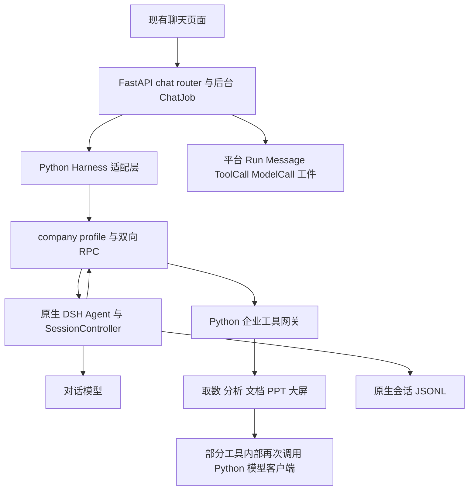

# AI 对话功能与 DSH 替换审查

日期：2026-09-26。当前项目：`E:/code/Yun_tian/the_company_agent/test5`。对照源码：`E:/code/Yun_tian/the_company_agent/deepseek-harness-master`。

**建议保留企业业务后端，修正并补齐当前 DSH 对话接入。直接用指定目录替换整个后端，不能解决已确认的主要问题；只换 DSH 源码目录也不会升级执行核心，因为项目已经使用同一份源码。** 若进一步改造架构，应围绕原生 SessionController、会话事件与企业工具插件展开，而不是退回功能更窄的裸 SDK。

用户确认三类症状都存在：回答/工具/产物效果差，复杂任务做不完或继续断，响应慢/卡住/状态混乱。本报告分别定位这些症状的代码原因、证据强度，以及换源码是否能解决。没有实施后端替换，没有修改既有业务源码。

## 证据与审查范围

1. **逐文件哈希核对。** `services/deepseek_harness/UPSTREAM.json` 登记 13,244 个文件，原目录和项目内 `.implementation/harness_migration/upstream` 均为 13,244 个匹配、0 改动、0 缺失，版本 `0.1.7-alpha.2`。这证明登记源码一致，不把额外文件、依赖和全部生成文件也宣称为逐字节一致。四个 company 插件的生成 JS 与当前 TS 转换结果全部一致。[结果](snapshot-comparison.json)
2. **实际配置核对。** 当前配置载入得到 `CHAT_ENGINE=harness`，内嵌上游目录、最大 2 个运行进程、默认上下文 32768、默认输出 4096、总任务时限 0。模型档位可覆盖上下文/输出预算，不能把部署默认值当每个模型的实际预算。
3. **原生子进程实测。** 临时目录内启动现有 DSH + company profile，模型是本机 `127.0.0.1` 固定桩，额外限制 Node 非回环网络连接。验证工具调用→工具结果→模型回答、进程重启后历史恢复、重启后重复 requestId 不重做，全部通过。共 3 次模拟模型 HTTP 请求、0 业务数据库连接、0 外部模型请求。一次冷启动约 2.000 秒，恢复启动约 1.328 秒；这是单次本地烟测，不是生产性能基准。[脚本](native_local_smoke.py)、[结果](native-local-smoke-results.json)
4. **针对性离线复现。** 原函数 AST + 内存对象验证模型参数映射、普通工具错误阻断、空产物交付审计、失败模型尝试的状态；Node 直接验证 profile；内存 HTTPResponse 验证代理帧缓冲。不是把旧文档描述当作已验证事实。[适配证据](adapter-boundary-evidence.json)、[profile 证据](profile-thinking-evidence.json)、[代理证据](proxy-buffer-evidence.json)
5. **现有测试。** 本轮 `node --test services/deepseek_harness/tests/*.test.mjs` 5/5 通过；前端流恢复测试 19 个场景通过；新增投影/模型配置离线检查 6 项通过。通过仅说明这些检查覆盖的行为，没有证明复杂真实业务任务质量达标。
6. **历史日志只读分析。** 当前 `STORAGE_ROOT` 指向 `E:/code/python_f/111/test5/storage`，读取该目录 9 月 24 日两份最近的 ai-chat 日志，仅提取事件、耗时、错误类型与工具名；没有重新执行日志中的查询。历史运行可能对应此前部署，不作为当前源码每条分支的实测证明。[脱敏摘要](historical-log-summary.json)

深审覆盖前端发送/选择/恢复、FastAPI 消息接纳与后台任务、Python Harness 桥接、Node profile/RPC/preset/压缩、DSH agent-loop/session/controller/SDK/provider、企业查询与产物衔接。未声称逐行读完 DSH 整仓所有 GUI/浏览器/native 实现；未做真实模型质量对比，未运行完整企业数据库集成场景。

## 当前真实执行结构

入口证据：`backend/app/modules/runtime/engine.py:21` 只分派一个引擎；`backend/app/modules/harness/runtime.py:312-328` 初始化并提交；`services/deepseek_harness/launch.mjs:31-59` 加载固定版本 CLI；`services/deepseek_harness/src/company-runtime.ts:180-201` 调用原生会话控制器。旧 `runtime/agent.py` 不是当前聊天主循环。问题不能简单归因为“两套 Agent 循环互相执行”，实际主要是同一原生循环周围的参数、工具、持久状态与显示没有完全对齐。

## 已确认问题及替换收益

### P1：普通工具内部错误会终止当前任务，并持续阻断同一会话的新任务

`backend/app/modules/harness/runtime.py:148-160` 的 `_database_failure` 把 `tool_error`、`tool_internal_error` 一律当数据库异常，不区分是否访问过数据库。`gateway.py:448` 会把普通 Python 未预期错误转换成 `tool_internal_error`，例如图表颜色解析异常。运行随后取消并把失败记录保留。

更严重的是 `harness/runtime.py:207-217`：每个新 Run 启动前，扫描该会话全部历史，遇到这些错误码就拒绝执行，没有仅限定“尚未确认结果”的状态，也没有排除与本次请求无关的已知失败。因此同一会话改问别的问题仍可能被挡住。离线复现“图表颜色解析失败/文件格式失败”被误分类，并连续阻断两个后续 Run。

改造应按工具实际结果与是否存在未完成操作分类；确定失败应可修参数继续；结果未知需要独立核对状态，而不是永久锁住整段会话。**换 DSH 源码不能修复 Python 中的这个判断。** 注意普通 `ToolExecutionError` 的码是 `tool_execution_error`，不能说所有工具失败都会触发此问题。

### P1：原生一轮结束被当成业务任务全部交付

`harness/runtime.py:518-552` 的成功门槛主要是原生 completed、事件游标到齐、正文非空。随后即登记 completed，并发送“任务完成，产物已交付”。没有逐项验证用户要求的 Word/Excel/PPT/图表是否都产生有效工件。

`runtime/grounding_check.py:85-121` 是数字匹配的提示性检查，不是交付验收。实测“文档已制作完成，请下载附件。”在 0 工件、0 回执下仍返回 `pass` 和 0 warnings；带数字的告警也不会改变 Run 的 completed。前端也没有处理 `delivery.audit` 的产品展示。

应保存本次请求的交付项、完成依据和已有工件引用；只有相应交付条件满足才标完成，缺项应显示部分完成及未完成原因。数字核验要保留字段、单位、范围与来源，仅“同一个数字在某处出现”不足以验收。**原生 DSH 自己也不会知道企业的这些交付条件，直接换后端无法自动补全。**

### P1：PPT 的“继续”恢复了对话历史，却没有恢复业务草稿

`presentation/draft.py:12-16` 用 workspace + runId 保存草稿；PPT 工具从本次执行上下文取当前 Run。`chat/router.py:375-378,477-499` 的草稿/未完成任务继承只在 openwebui 路径启用。Harness 新一轮拥有历史文字，但新 runId 没有旧草稿；继续写页/结束生成会遇到“尚未创建 PPT 大纲”，或模型从头重建。

需要独立、稳定的业务任务/草稿引用，或在同一请求资源范围内显式恢复到新 Run。原生会话恢复通过实测，并不意味着外部业务草稿也恢复了。**这是平台业务状态问题，换同源 DSH 不解决。**

### P1：模型 thinking 配置在不同路径上含义不一致

`harness/context.py:78-83`：原生 Messages 分支只依据 effort 是否为 off 决定 thinking；单独设置 `thinking=disabled` 会变成 `thinking=enabled`，并默认 high。兼容协议分支虽然在 Python 输出 disabled，`services/deepseek_harness/profile.mjs:59-66` 却未把这个字段映射到提供商；配置 disabled 与不设置会生成完全相同 profile。

同时，工具内 `providers/model.py:158-170` 对 thinking 又采用另一套参数处理；管理员以为一个档位只有一种执行策略，实际上外层 DSH 与内层 Python 请求不完全一致。应建立统一的模型能力/协议映射，验证实际发出的请求体，并让界面可见有效策略。不能仅补一个不被提供商接受的任意字段。**同一份上游适配器没有办法修复它收到参数之前的错误映射。**

### P1：网页搜索/深度研究开关没有进入 Harness 执行策略

`apps/web/app.js:2131-2132` 展示两个选项；`chat/router.py:455` 保存 mode。`harness/context.py:118-131` 没使用该选择，`harness/runtime.py:327-328` 传给 DSH 的 mode 固定为 queue。后者是消息入队方式，与网页/研究业务模式不是同一概念。

当前 company profile 没加载原生网页搜索、规划和研究执行组合。应给搜索接实际 search/fetch 工具和来源交付，给研究接任务拆解、资料获取、阶段进度与验收，并改造对应前端。原生源码有构件，但普通聊天模型凭据不必然提供搜索服务。**需要功能接线，换目录本身不生效。**

### P1：工具内部的嵌套模型调用是已出现的长等待来源

`analytics/queries.py:204` 的自然语言取数仍调用 `model.chat_for_run`；`providers/model.py:472-515` 使用 Python 模型客户端。DSH 主模型调用一个业务工具后，要同步等待工具内部的另一次模型调用。嵌套调用不是第二套对话 Agent 循环，但确实增加延迟和失败点，且隐藏了中间推理状态。

9 月 24 日日志中的两个例子：

| 历史记录 | 观察到的行为 | 能得出的结论 |
| --- | --- | --- |
| ai-chat-31008，整轮约 755.3 秒，31 次工具调用 | 某次 NL 生成约 216.066 秒，实际 SQL 执行约 0.256 秒；另一次模型失败约 150 秒 | 这次主要等待发生在模型生成方案，不应误称数据库查询慢 |
| ai-chat-31180，整轮约 1208.8 秒，21 次工具调用 | 多次 NL 模型等待 90–180 秒后失败；大屏内部模型约 300.5 秒后失败 | 换外层对话服务但保留同样嵌套模型，仍会保留这些慢点 |

这些记录也有成功保存的工件，不能据此断言整轮没有产物。当前源码保留该链路，历史数值不等同当前性能基准。建议优先复用查询结果、减少重复 NL 转换、明确工具所需结构化输入和数据元信息；简单确定任务可走现有 SQL/查询结果绑定路径，复杂 NL 必要时继续保留，但统一模型策略、预算、进度与错误回执。需要真实模型对比才能确定选择哪个模型/端点能改善质量与时延。

### P1/P2：使用 OpenCode 代理时，小流式片段被定长读取聚合

`services/opencode_proxy.py:85` 调用 `response.read(65536)` 再转发。对于长时间保持连接的小块 SSE，上游可能已发出文本，代理仍等到读够或响应结束。内存 HTTP 分块响应复现：当前 read 一次吃掉两帧；read1 可先返回首帧。这解释特定端点下“长时间不出字，最后整段出现”的可能机制。

只影响经过该代理的请求，不应推广到所有模型，更不能用历史日志证明每次卡顿都是此因。应使用真正的增量转发并验证首帧、断流和取消行为。**换 DSH 后若仍经过同一代理，问题保留。**

### P2：当前 profile 的能力缺口限制了复杂任务，但不能无差别打开所有插件

`profile.mjs:13-47` 是自建组合，没有继承原生 base；保留原生循环、会话持久化、控制器、压缩和有限重试，但未接原生子代理、goal、plan、网页工具、工具结果剪裁等。工具总并行上限为 1，company-preset 所有工具又返回 `isConcurrencySafe=false`。Python 工具消费也在同一执行线程；仅把数字改大不会建立完整并行链路。

工具结果用 `company-preset.ts:30` 的 JSON.stringify 完整渲染，缺少原生 base 的 result-pruner/spill 组合；当前部署默认上下文 32K、输出 4K，复杂取数和产物任务更容易较早压缩或碰到输出预算。它们是可核实的配置/能力限制，不是已经统计出的质量损失率。

建议先接结果裁剪/引用/按需读取、明确任务目标与完成条件，再有选择地加入分析/检查子代理；可并行的独立渲染/资料任务需要独立执行上下文和事务。数据库测试仍维持用户规定的小范围单业务查询并发，不把插件并行能力当作加压授权。原生 Office 技能还依赖实际运行库、渲染检查和平台工件登记，不是加载名字就能替代现有产物链。

### P2：排队与推理阶段缺少足够的可见状态

`harness/client.py:98-116` 等待会话锁和全局两槽位，可取消；默认总时限为 0 时没有额外排队截止时间。Run 已进入 running，界面只显示“准备运行环境”，看不出前面有任务占用。源码里的启动控制请求 60 秒超时并不限制此前的槽位等待。

`harness/projection.py:37-46,61-66` 只转换正文，原生 reasoning delta 与持久 reasoning 块未投影。用户看到的长空白不一定代表引擎停了。应分别显示排队/模型处理/工具执行/压缩/交付校验状态；必要时展示供应商允许公开的推理摘要或进度，而不是要求界面暴露内部思维链。

长驻进程/池可以减少重复初始化，本轮单次初始化量级约 1–2 秒，不能据此承诺能消除日志中的数分钟等待。先测等待分布，再决定进程生命周期改造的优先级。

### P2：失败与恢复的运行账目仍有不一致

`harness/runtime.py:493-507` 以是否有 usage 把未 interrupted 的 assistant/attempt 记作 completed，没有按其中 finish 的 error 原因判定。原生成功响应通常直接产生 assistant/message；不能采用该处“正常成功先 attempt 再 message”的注释理解原生协议。离线验证了带 usage 的 error attempt 被记 completed。

上一轮功能审查还确认 `runtime/chat_liveness.py:127-133` 先提交 Run，再修改悬挂 ModelCall；后续没有统一提交时会留下“Run 已失败，ModelCall 仍 started”。此次重读仍是该顺序。应将恢复状态在正确事务边界提交，并区分“发生了计费/usage”和“调用成功”。这是平台账目/状态问题，不是原生核心缺恢复。

### P2：主聊天模型没有获得附件的原生图像内容

当前并非完全不能识图：`builtin_provider.py:1093-1107,1200-1219` 的 read_file 可以调用独立 vision 档位；`providers/model.py:697-728` 实际发送 image_url。不过辅助识图采用固定的企业 OCR/图表提取提示，而不是当前用户的具体问题，结果以文字返回。主会话在 `harness/runtime.py:328` 只提交 text，company 工具又统一把结果转换为 JSON 文字，主模型看不到原始图像块。

因此精细图片问答、版式比较、局部视觉追问可能受这次转述限制；配置 `input_modalities=['image']` 并没有自动接通图像链路。原生 DSH 的附件系统和模型适配确实支持独立 ImageBlock，可按选定模型能力接通，同时保留文本解析。若继续使用辅助 vision 模型，应至少传入当前具体问题，并明确主模型的依据是识图结果。具体源码对照见前端分项 F-UI-05。

## 替换方案比较

| 方案 | 收益 | 必须承担的改造 | 判断 |
| --- | --- | --- | --- |
| 把内嵌目录换成指定原始目录 | 登记源码完全相同，没有执行核心升级 | 原始目录当前没有构建好的 CLI lib；还需安装/构建并重新指向 | 不作为修复方案 |
| 直接改用官方 Python/TS SDK | 减少部分自有调用封装 | 当前 stdio SDK 只暴露 initialize/session-prompt/shutdown；缺单会话 cancel/resume/history/fork 和实时 assistant-stream 转发 | 对当前完整聊天需求会倒退 |
| 使用完整 DSH Web 及后端作为独立产品 | 可获得较完整的原生聊天交互与工具组合 | 现有登录、资源选择、企业工具、文件工件、历史、模型档位、业务页面全部需要桥接 | 可做新产品分支，但不是直接无缝替换 |
| 保留企业后端，改造 DSH SessionController 接入及企业 profile | 修正已确认问题，并按需恢复原生能力；复用现有数据/知识/产物 | 收敛事件与状态映射，补任务/草稿引用，统一模型策略，接前端交互与验收 | **推荐** |

原生 SDK 的局限来自 `packages/sdk/server/src/server.ts:95-128,248-295` 与 SDK 协议定义；完整控制器在 `packages/api/session-controller/src/index.ts`，包含 cancel/page/follow 等。SDK 的 run 等 idle 不等于企业交付齐全。现有 company 插件已经使用 SessionController，不需要为了“原生化”再重写一个 Agent 循环。

## 推荐落地边界与顺序

**第一阶段：先修现在能证明的问题。** 修改错误分类和历史阻断；统一 thinking/effort 的实际请求映射；修代理增量转发；把 PPT 草稿/业务任务从一次 Run 的寿命中分离；把交付完整性作为真正完成条件；使网页/研究模式有实际能力或明确状态。补齐计费状态提交和可见进度。保持当前已有冷恢复、幂等、取消与真实产物登记能力。

**第二阶段：补原生能力，收敛重复状态。** 让 DSH session/event/turn-end 负责对话事实，平台 Run 作为业务投影；保留企业任务、查询结果和产物账本。通过 profile/plugin 接 result-pruner、plan/goal、子代理和必要工具，给前端增加原生事件适配。子代理默认承担明确的资料分析或产物检查职责，有完成条件和预算，不能把更多代理等同更高质量。

**第三阶段：用数据决定长期架构。** 固定同一批任务、模型、输入与工具，对比修复后的 company profile 和增强 profile。若瓶颈仍在启动/恢复与状态一致性，再把每 Run 新建进程改成长驻会话服务/有界进程池。若瓶颈在嵌套模型/上游端点，先改那条链；若在 PPT/Word 渲染和事实口径，就改对应工具，而不是继续替换会话引擎。

保留范围：账户/工作区、数据源与业务查询、知识库、工作流、告警、查询结果与数字口径、模板、PPT/Word/Excel/大屏产物、用量账本及现有平台页面。改造范围：聊天任务接纳后的事件/状态映射、company profile、模型映射、工具边界和聊天界面。新旧版本应在新会话或明确的迁移点切换，不在已执行工具的一轮中途改引擎重放。

## 验收任务与指标

| 场景 | 必须验收的行为 | 记录指标 |
| --- | --- | --- |
| 普通多轮与长上下文 | 记得明确条件；压缩后仍有任务、关键来源、未完成项 | 首事件/首正文、压缩次数、上下文尺寸、约束保留 |
| 查询→图→Excel→Word→PPT→大屏 | 实际要求的交付物逐项存在；数字、单位、范围一致；部分失败明确 | 交付完成率、数字核对、工具/模型调用数、重复查询数 |
| 分阶段 PPT 中断后“继续” | 保留页数、模板、已写页与来源，完成剩余页 | 草稿复用、重做页数、重复工件 |
| 图表工具内部异常后再提问 | 当前错误准确显示；确定失败不锁死整段会话 | 新任务能否运行、错误分类 |
| 停止/断网/刷新/进程重启 | 已提交内容可恢复；不把未知结果报成功；不重复已完成调用 | 终态一致性、重复调用、剩余活动状态 |
| 搜索/研究/附件 | 选择的模式真正改变可用能力；来源可追溯；图片实际传入模型或明确走解析 | 模式覆盖、来源/附件引用、可见阶段 |
| 模型参数对照 | 外层和内层请求的 protocol/thinking/effort/token 预算符合配置 | 实际请求体、首正文/总耗时、失败类型 |
| 两个长任务时提交第三个 | 显示排队，可取消；与模型慢/工具慢区分 | 排队时间、初始化时间、推理时间、工具时间 |

协议和状态先用本轮这种本地模型桩验证；质量必须再用真实模型与固定样本验证。本任务没有得到一个可测量的“最佳效果”排名，所以不承诺增强 profile 一定提升多少成功率或速度。能确定的是：同源替换不解决当前已定位的适配和业务问题，而上述改造范围直接对应用户的三类症状。

## 详细审查与复现材料

- [原生 DSH 能力、SDK/SessionController、Windows 部署边界](native-dsh-review.md)
- [当前 Python/Node 适配层审查](current-adapter-review.md)
- [聊天前端、事件契约和迁移边界](chat-ui-migration-review.md)
- [源码对比脚本](compare_snapshots.py)与[结果](snapshot-comparison.json)
- [真实本地子进程验证](native_local_smoke.py)与[结果](native-local-smoke-results.json)
- [适配边界复现](reproduce_adapter_boundaries.py)、[模型 profile 复现](reproduce_profile_thinking.mjs)、[代理缓冲复现](proxy_buffer_repro.py)
- [历史日志脱敏摘要](historical-log-summary.json)
