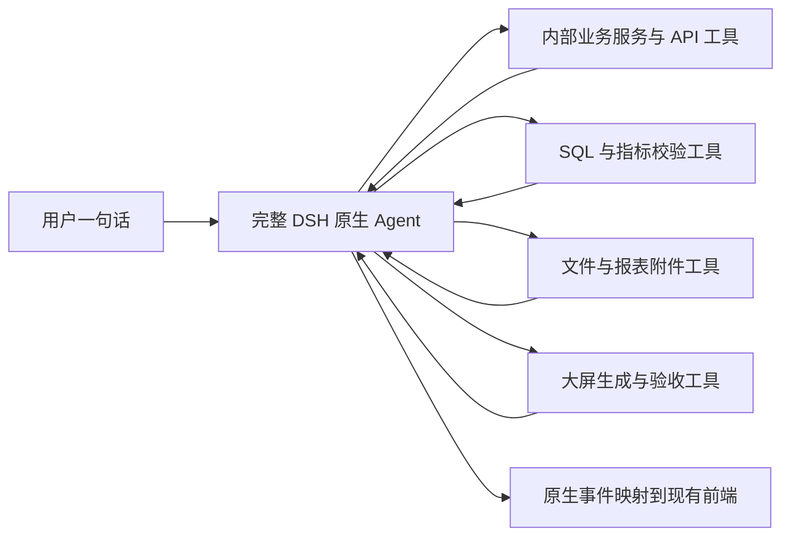

# AI 财务大屏会话的执行链路整改方案

状态：以下问题定位保留为审查基线。2026-09-28 已实施原生标准预设、透明 SQL 执行、财务口径校验、大屏验收、原生交互与文件交付；实际验证记录见 [DSH 原生接入修复验收](dsh-native-repair-20260928.md)。本文后续关于专用指标/附件适配器的建议不代表已经注册这些接口。

用户本轮明确要求“全部套用 DSH”。因此本方案采用原版 DSH 执行机制与标准预设作为接入基线；任务拆解、计划推进、上下文延续和工具循环由 DSH 负责。下文的业务定义、查询核验和交付检查均作为业务插件能力，不能再演变成另一套宿主编排或隐式的二次模型改写。

审查会话：`01M3K50ZN3Z80FJRGPTFKVVS7J`。原始请求：“财务上个月的应收做成数字大屏”。

原始问题定位阶段读取该会话的原生持久化日志、已保存工具回执及代码，没有重跑该历史任务。随后的实现验收使用临时 SQLite 和真实 OpenCode 模型，未据此推定 szh_new 已具备应收映射。会话标识通过平台既有工作区、用户和会话 ID 的哈希规则定位。私有问题证据位于 `.implementation/chat-01M3K50-review/`。

## 一、这次实际发生了什么

模型为 `deepseek-v4.1-flash`。原生轮次耗时 70.514 秒，10 个模型步骤、15 次工具调用；工具调用区间合计 23.194 秒，其余约 47.320 秒为调用区间外的模型交互及宿主处理，不能全部解释为数据库耗时。

调用组成：2 次 Skill、1 次自然语言查询、1 次数据源发现、1 次 overview、5 次 schema、5 次定向字段读取。大屏创建调用为 0。

| 证据 | 已确认的问题 |
| --- | --- |
| 第一条查询回执 `494b3487-6f01-448d-b330-52af21d58ef8` | 应收请求执行了资金支付汇总和资金支付计划查询，返回付款方向的 70 行数据。 |
| 同一回执的模型解释 | 明确写出“以未付金额作为应收口径的近似”，并承认客户采用未经核验的名称匹配。 |
| 同一回执的数据 | 70 行客户名称全部为空；实际计划日期为 2026-08-03 和 2026-08-31。最终回复却称“覆盖 8–9 月”，没有按真实日期字段陈述。 |
| `modelUsage.userScope.semanticValidation` | 值为 `not_proven`；传入原始用户要求不等于实际 SQL 符合其业务含义。 |
| 5 次 schema 调用 | 多次改写相近关键词，候选仍在销售、付款和财务报表之间切换；没有稳定的应收指标定义与适用数据映射。 |
| system/message 与 assistant/message | 中文和不输出自我推演的规则已经加载，但可见正文仍反复输出英文行动说明，最终回答也含英文开头。 |
| 财务利润／成本报表字段 | 存在报表附件字段；本次没有继续读取对应记录或附件，不能认定附件里一定没有所需数据，也不能认定一定有。 |
| 任务交付规则纯函数复现 | “财务上个月的应收做成数字大屏”和“生成应收数字大屏”均返回空交付约束；只有 Excel 等文件类型被识别。 |

这次定向读取均成功，没有再出现上轮的旧 offset 越界。说明上轮局部修复生效，但业务指标校验、能力发现、交付闭环仍然缺失。

## 二、代码层面的原因

1. `analytics/semantic.py` 的财务域别名扩展会同时加入应收、应付、付款、回款等词；它们是同一业务域中的不同方向，不能当作可替代指标。复合主题保留候选位并不能保证单一应收请求排除付款指标。
2. `analytics/queries.py::natural_language_sql` 使用独立模型提示，未自动继承主助手全部业务规则。当前执行前主要校验 SQL 语法、表字段与访问范围，另有巡检专项校验；缺少财务指标、时间含义及关联依据的强制验证。
3. 主助手可以发现结果方向不对，但此时错误 SQL 已执行且回执已标记成功。正确性依赖另一个模型随后识别错误，不能形成稳定契约。
4. 业务应用注册目录已有分析、文件、文档和大屏能力，但缺少统一的“业务指标 → 内部接口／表字段／附件”的能力目录。发现一张含附件的报表表，并不会自动解析附件来源。
5. `business_worker/tasks.py` 只用文件关键词识别交付物，`deliveries()` 只验证 Artifact，没有把报表对象、可用预览、数据快照和目标指标一起验收。
6. 输出正文主要直接采用模型内容；现有业务证据回复仅覆盖部分设备与库存场景，财务场景没有对应的确定性结果摘要。

## 三、推荐架构

直接采用 DSH 的原生会话、标准执行预设、模型连接、工具协议、流式事件、任务清单、交互问题与持续执行能力。当前自定义精简配置不作为“完整套用”的完成标准。业务工具直接接到同一个 DSH Agent：

Skill 负责业务操作方法和示例；插件代码负责参数、指标规则、数据读取、快照与验收。关键规则不依赖模型是否主动加载 Skill，也不把每种业务写进 DSH 核心循环。

### 与原版源码对照后明确的接入整改

- 上游 `packages/core/agent-loop/src/agent.ts` 在工具结果后继续内部步骤，无工具调用或明确结束才结束轮次；用户无需发送三条消息来驱动三个业务阶段。当前项目也已使用这段原生循环，本次日志的 10 个步骤证明循环在运行，不能把问题说成 DSH 缺少多步能力。
- 当前 `services/dsh_host/profile.mjs` 手工列出精简插件，`company` 预设为 `plugins: []`，循环并发上限为 1。上游标准预设包含 todo、ask-user、present、文件及后台任务等能力。接入应从上游支持的 bundle／标准预设派生，用业务插件补充，避免继续手工重建一份逐渐偏离上游的执行配置。
- 当前 `host.mjs` 的 capabilities 明确关闭 `steer` 和 `questions`，相关路由返回 501。原生能力需要连同事件和当前前端组件一起接通，不能只打开能力标志。
- 当前 `builtin_provider.py` 会把 DSH 的 SQL 调用改为自然语言查询，`queries.py` 再调用一次模型生成 SQL。DSH 调用的业务工具应直接执行明确参数并保留实际回执；参数或业务口径不合格时返回结构化问题，让同一 DSH Agent 修正，不能在工具内部静默换任务或换 SQL。现有分析页面确实需要的自然语言查询可以保留为显式独立能力，但不再强制套在 DSH 工具调用上。
- 原生轮次状态、任务清单、业务报表验收属于不同事实。大屏验收通过插件／原生扩展反馈给当前 Agent 和前端，不能用另一套关键词驱动的聊天引擎接管执行。

“完整采用”指采用适合当前产品入口的完整原生执行机制及其扩展点，不是把 desktop/web/sdk 等互斥启动入口全部同时加载。前端沿用现有视觉，只适配原生会话事件和组件。

## 四、实施顺序

### P0：先保证查对指标、如实判定完成

**1. 结构化业务任务。**

由 DSH 理解请求并使用原生任务清单推进；业务插件保存 `metric_id`、时间口径、组织范围、维度、数据源和交付证据。区分月度发生额与月末余额。先使用已有业务定义；确有歧义时由原生交互能力询问一个业务问题，不要求用户提供表名。单句和连续三句在相同用户要求下使用相同业务约束，不另写一个阶段编排器。

**2. 查询执行前的业务验证。**

新增财务语义校验模块。依据已登记的指标字段来源和已核验关系，验证计划／SQL 的业务方向、时间字段、过滤范围、连接字段和数据粒度。应收请求引用付款金额来构造指标、无证据的客户名称 JOIN，都必须在执行业务 SQL 前返回结构化失败。未知映射返回 `metric_unmapped`；已知方向冲突返回 `metric_mismatch`。不能只搜索 SQL 文本中的中文词或相信模型自报“已验证”。

自然语言 SQL 继续用于探索和未模板化查询，但必须经过同一验证器；不得通过 SQL 列别名或解释文字改变指标含义。已有通用权限和语法校验继续保留。

**3. 大屏交付验收。**

把 dashboard/report 纳入要求和交付注册。验收至少包含：真实报表对象存在、引用本任务的有效数据快照、指标一致、预览资源可用。预览渲染失败与数据尚未具备要分别记录。没有交付大屏的轮次不能仅因模型自然结束而判定业务任务完成。兼容既有 partial，并明确“缺业务定义”“待补数据”“查询失败”“渲染失败”的原因。

### P1：打通业务服务、数据库和附件

**4. 建立业务指标和能力目录。**

每个指标记录业务方向、时间语义、金额单位、数据粒度、可用维度、来源适配器、字段映射和核验版本。区分“已有可调用能力”“可从已确认字段计算”“存在待解析附件”“目前缺少映射”，不把发现失败说成数据不存在。

优先复用内部业务服务的 Python 方法，避免 Worker 绕 HTTP 调自己的接口。只有确实独立部署的业务系统才用注册 API 适配器；共享权限、统计口径和错误定义。API 本身没有应收口径时，不能因为接通了接口就宣称得到应收。

对 szh_new 首先定位已有财务功能、报表配置、低代码实体关系及报表附件的来源。真实应收来源尚未证明，本方案不指定虚构的应收表。现有财务报表附件属于待查线索：必须核对附件记录、格式、可访问路径及内容后才能登记为能力；来源不明的远程地址不自动访问。

建议工具契约为 `resolve_business_metric`、`query_finance_metric`、`read_business_attachment` 和既有大屏生成工具；这些名称是拟新增接口，不是当前已存在的能力。

**5. 一次取数、多种交付。**

标准指标由确定性适配器执行，生成含指标定义版本、参数、字段来源、查询／API 证据、时间范围、缺失情况的快照。回答、Excel、PPT 和大屏复用同一快照。金额汇总由后端计算，模型负责解释，不重新抄写数字或按文件类型重新查询。

### P2：控制耗时与展示

**6. 有限发现与复用。**

数据源已选定时不再重复发现。标准指标命中目录直接取数；未命中允许有限的结构化候选搜索，默认最多两轮，然后输出明确的能力缺口。同一来源版本和同一指标的发现结果可复用，但必须随元数据、字段映射、权限和指标版本失效。不能跨用户复用越权结果。

不以增大模型轮数和工具数量解决缺失映射。进度提供实际阶段与等待原因，区分排队、模型、数据库、附件解析、制图耗时。

**7. 用户输出由真实状态驱动。**

进度采用中文阶段文案；默认结果由已验证快照生成简洁摘要、必要口径、预览和文件卡片。模型技术分析放入按需查看的诊断详情，不直接拼入正文。不要用删除全部英文的正则处理，否则会破坏代码、表名和文件名。最终日期来自真实日期字段，不能根据标题或模型记忆猜月份。

前端保留现有外观，主要改结果与状态组件。大屏缺数据时不生成带零值的假成功页面；明确显示待完成原因，并保留已验证部分。

## 五、验收标准

至少覆盖以下实际任务，并同时检查工具轨迹和页面交付，不能仅以单元测试通过代替验收：

1. “上个月应收做大屏”：具备已确认映射时准确取数并显示真实预览；没有映射时在有限发现后明确未完成，不能查询付款金额冒充应收。
2. 相同指标、时间和数据源下，单句复合请求与三句追问使用相同口径，金额与记录范围一致。
3. 应收、回款、付款和应付分别测试；相反方向的字段不能因名称近似通过校验。
4. 非 0/1 删除标记、空业务日期、全部客户 JOIN 不匹配、缺必要金额字段，应给出准确的缺失原因。
5. 财务数据只存在于已注册 API 或报表附件时，适配器能够沿已授权来源读取；没有来源时报告缺口，不自动猜 URL。
6. 模型已结束但报表未创建、预览失败、数据快照失效，业务状态不能变成已完成。
7. 前端流式中文进度、运行中滚动、历史恢复、生成后的预览与下载均可用。
8. 记录首次反馈、各阶段耗时、模型调用数、输入量、重复工具次数及最终状态；标准指标不再出现五次改关键词搜索。以本次 70.514 秒作为问题基线，不预先承诺未经实测的提速比例。

真实复验遵守项目的本机数据库限制，从小范围串行开始；异常立即停止。需要以当前 opencode / deepseek-v4.1-flash 做模型、数据和浏览器连贯验收，才能宣布完整链路已修好。

## 六、范围与交付

第一批交付应同时包括财务指标校验、dashboard 交付验收、结构化缺口结果，以及本次真实回执的离线反例回归。第二批建立 szh_new 的已核验财务能力映射和附件／API 适配。第三批完成快照复用、有限发现和中文结果组件，再进行同场景真实模型对照。

以完整 DSH 原生接入替换当前精简拼装配置，业务后端改为透明工具与插件，去掉隐式二次规划和业务任务改写。能够运行 SQL、返回非空行、正常结束模型轮次，都不能单独证明用户的业务任务已完成；业务结果检查通过原生扩展点反馈，不另建聊天编排。
