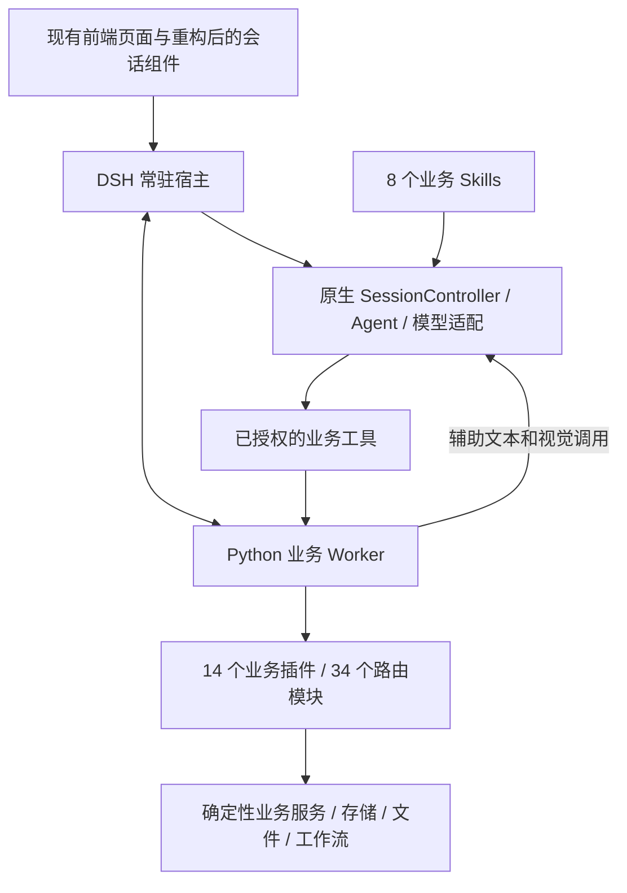

# DSH 企业平台重构交付记录

日期：2026-09-26。重构前基线已推送至 Gitee `main`：`a9e8a9c433be6e62f05550b0a2782c7f6d51a847`。重构分支：`codex/dsh-business-platform`。

后续已按用户指定的本机 `szh_new` 与 OpenCode `deepseek-v4.1-flash` 开展真实测试；实测结果、发现的功能问题和修复见 [真实业务与模型验收](dsh-live-business-acceptance.md)。本文下方测试表记录的是首次交付时的隔离验收，不代表真实模型质量。

## 实际架构

统一运行入口已切为 `backend/start_server.ps1 → backend/run.py → services/dsh_host/launch.mjs`。原生 DSH 是常驻宿主，管理对外 HTTP/TLS、会话、模型、Agent 工具循环、队列、取消和持久事件。Python 业务 Worker 通过私有双向 JSON-RPC 接入，不启动 Uvicorn 或旧 ChatJob 聊天循环。

既有业务服务的可用逻辑继续复用，业务应用按清单登记路由、工具、Skill、前端入口及依赖。当前清单覆盖全部既有路由模块，34 个内置工具各有归属。新增应用不需要复制聊天循环。知识库向量嵌入仍使用专用 provider，所有对话与辅助文本/视觉生成由 DSH 路由处理。

原生源码版本固定为 `0.1.7-alpha.2`，随仓库提供 26,790,501 字节源码包、MIT 许可证及 13,244 个源文件的锁清单。安装器默认使用仓库内源码包；已验证在临时目录全新解包后所有文件哈希一致。新克隆不依赖开发者机器上的原始源码目录。运行时安装产物与依赖不进入 Git。

## 对话及业务功能

| 范围 | 已实现行为 |
| --- | --- |
| 主会话 | 原生常驻 session、多轮上下文、流式正文/思考/工具事件、模型用量台账；请求幂等防重复执行 |
| 队列 | 受理、编辑、移除、串行执行；编辑同时更新模型业务任务约束与持久用户消息；跨会话错误目标返回冲突 |
| 取消与恢复 | 活动运行取消、删除会话取消活动与队列、订阅断开不取消；取消终态保留实际已输出正文，与刷新历史一致 |
| 重启 | 从原生持久事件与业务台账核对已受理运行；未执行队列可继续，已执行而中断的业务不自动重复 |
| 跨轮业务 | 独立 `task_id/draft_id`，自然语言延续与明确任务选择，PPT 草稿可继续及修改；修改任务需要本轮新交付 |
| 完成判断 | 核对真实工件记录和存储；缺少所要求文件返回 `partial`，附带缺失清单，正文自称已完成不算交付 |
| 错误处理 | 普通参数、文件或渲染失败不冻结后续聊天；实际数据库 provider 与内置查询故障按 datasource 分类停止相关访问 |
| 历史与大结果 | 旧历史仅首次迁移；过大历史/工具结果保留完整来源和分页读取，模型侧按预算裁剪预览 |
| 模型 | 主对话和辅助请求统一协议与单次输出/上下文配置，正确处理关闭思考；独立 API/工具/控制线程池避免反向请求互相等待。整项任务累计预算尚未统一 |
| 图片 | 辅助 OCR 将图片注册为原生附件；主模型声明 image 模态时直接接收上传图片，文本主模型通过 `read_file` 调用视觉角色 |
| 业务接口 | 既有登录、上传、下载、工作流、知识库、报表和管理路由由进程内 ASGI 保留，无第二个公共后端服务 |

首次保存死锁、自动保存无限重试、正式工作流输入误取草稿、结构化 JSON 精度丢失、Skill 编辑丢配置、调度任务错误标记成功、已归档工作区仍派发、代理 SSE 缓冲及模型台账事务顺序等审查问题已在相关代码中修复并增加回归。

## 前端保留情况

保留既有页面外壳、主 DOM、聊天输入区、导航及全局样式。新增独立会话传输/状态组件和有数据才出现的过程组件；工作流和模型配置通过原组件调整功能。原 `app.css`、`business-chat.css`、`ai-workbench.css` 未修改。

1440×900 与 390×844 两个尺寸，共 48 项外壳几何比较最大差异 0 px，均无横向溢出。新增任务/队列/思考内容使用独立样式范围。Analytics 已完成类型检查和实际构建；当前入口及 89 项依赖完整，依照原 `emptyOutDir:false` 配置保留旧哈希资源。

具体记录见 [前端实施与隔离验收](dsh-frontend-delivery.md) 和 [布局实测](dsh-chat-layout-verification.json)。

## 验证证据与复现

首次交付时的数据库集成使用临时 SQLite；原生模型请求仅到本机受控桩；当时未连接 `szh_new` 或任何在用、局域网、远程业务数据库，未修改数据源绑定。后续本机真实测试单独记录于上方链接，不能混同下面模型桩的耗时。

| 检查 | 证据 |
| --- | --- |
| 语法和安装 | `python backend/compile_check.py`：373 个文件通过；`python backend/run.py --check`：Node 24.16、原生版本和 14 个插件检查通过 |
| 插件/技能/启动/代理 | `tests/run_isolated_backend.py tests/backend/test_dsh_platform_contract.py tests/backend/test_skill_contracts.py`：9 项通过，含真实本机 HTTP 代理首块 SSE 无须等待后续正文 |
| Worker 与业务回归 | `tests/backend/test_business_worker.py`、`test_schedule_result_contract.py`：最终 32 项通过；此前联同原调度发布修订和分析取消的扩大回归 55 项通过。覆盖实际 DOCX 交付下载、稳定 PPT 草稿、模型视觉合同、原生工具历史、预算与台账、线程池饱和、manifest 依赖、数据库故障分类及两项最终交叉回归 |
| 原生宿主 | `node --test services/dsh_host/tests/*.test.mjs`：最终 8 项通过，16.89 秒。真实 DSH、临时原生持久目录及本机 OpenAI/DeepSeek 协议桩；覆盖模型参数、流式事件、技能、工具、队列、取消、重启、隔离、大结果分页、历史迁移及图像 |
| 全链路 | `python -X utf8 tests/dsh/real_platform_smoke.py`：真实 Node DSH + 真实 Python Worker + 临时文件 SQLite，最终 11 类场景全部通过、18 次模型桩请求、26.781 秒，含取消半段正文一致与排队 PPT 改 Word 约束同步；见 [集成结果](dsh-integration-result.json) |
| 前端 | 会话离线状态、旧恢复、工作流回归、精度契约、Vue 类型检查/构建、静态依赖及两尺寸浏览器测试；具体数量与命令见前端实施记录 |
| 源码可复现 | 固定源码包解包，13,244 个源文件逐项哈希通过；原始用户源码不修改 |

## 已知实现范围

- 能力接口如实声明：网页检索与深度研究尚未配置，原生执行中 steer 和结构化提问尚未接入，前端不显示为可用。普通聊天、Skill、队列、取消、任务与交付已接通。
- 辅助 `json_object` 使用提示约束和真实解析校验，不声明供应商原生严格 JSON Schema 支持。辅助旧 stream 回调收到完整结果后触发，主对话走实时原生增量。
- 现有 HTTP 文件接口经过 Worker 的字节保真转发，目前会聚合一次响应；本次没有实现跨 RPC 的大型文件分块流传输。
- 本机模型桩证明协议、状态和真实业务操作可运行；不证明真实模型内容质量、所有第三方端点兼容性或现场数据库查询性能。没有把这些未测范围写成已验收。
- 旧聊天引擎代码及相关兼容测试保留在仓库，当前统一启动入口不使用它们。本次完成运行架构和业务插件边界重构，未为改写语言而重写所有确定性 Python 算法。
- 本次交付是代码、构建资源和隔离验收结果；在用服务未重启切换。当前工作区使用重构分支，重构前 `main` 保留可回退基线。

完整私有 RPC 与公共 API 约定见 [重构契约](dsh-platform-refactor-contract.md)。启动命令和源码安装方式见根目录 [README](../../README.md)。
