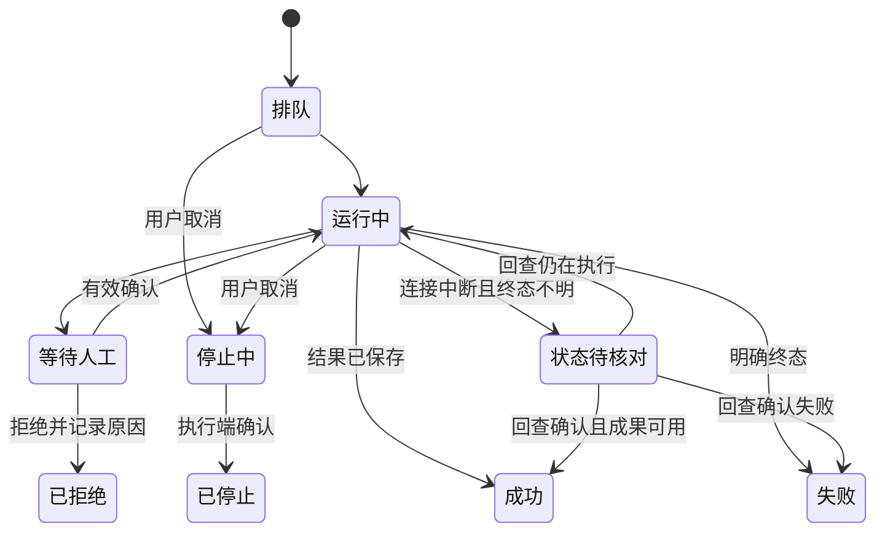

# 产品功能与用户体验

版本：0.1，规划待评审。日期：2026-10-20。作者：agent-1020-product。关联任务：T-agent-1020-product-01。

**主要读者：客户业务负责人、产品经理、交互设计师。** 开发者据此理解业务行为，具体技术设计见 [02_架构与实现设计.md](02_架构与实现设计.md)，排期和测试见 [03_开发计划与验收.md](03_开发计划与验收.md)。

## 1. 产品要解决什么问题

建设面向中国制造企业的 Agent 平台：让车间人员能查数据、做检查、处理异常，让工程师能用设备资料和历史记录完成分析，让开发人员能把成熟做法配置成可重复运行的应用和流程。

**首发交付假设：单企业私有化部署。** 企业内组织、工厂、工作区隔离和上游租户边界必须生效；完整多客户 SaaS 的商业计费与运营另行立项。

用户应拿到三类结果：**可信的业务判断、可追溯的执行过程、可继续使用的成果。** 回答“设备可能有问题”不算完成；要说明哪台设备、哪个时间窗口、什么现象、依据在哪，以及下一步由谁处理。生成报表后，用户应能打开、筛选、编辑和下载同一份成果。

本产品完整复用成熟内核，开发重点放在制造业务和整合体验。

| 来源 | 已明确的复用方式 | 用户看见的结果 |
|---|---|---|
| Open WebUI | 完整对话与 Agent 内核、前后端和界面，按业务微调 | 成熟的多轮对话、附件、工具调用、子 Agent、引用、历史和成果交互 |
| Dify | 完整保留应用、Agent、工作流、节点、知识、插件、调试、发布和运行能力 | 开发者使用原生专业工作区；业务人员直接运行已发布应用和固定流程 |
| qKnow | 整体视觉、信息层次、业务组织和功能参考，包含原预留功能 | 统一且美观的入口；知识、图谱、应用、设备和运营各有适合的页面 |
| Test5 指定范围 | 提取免写 SQL 分析、报表生成、设计器、组件模板和直接依赖 | 数据可查询，模板可换数据，报表可编辑，生成结果可回查 |

**“重写”指重组为一个成熟产品，不再重造聊天执行循环和工作流引擎。** 各成熟应用先保留原生技术栈，统一入口、身份、资源引用、业务权限和结果。具体聚合接法需要先做技术验证。

本地 Test5 当前查到的是自然语言转 SQL、受控 SQL、HTTP 取数及 Elasticsearch 等 provider，本文对用户入口命名为“免写 SQL 分析”；不据“NoSQL”旧称宣称已具备 MongoDB、InfluxDB 等未核验引擎。

## 2. 谁使用，分别完成什么任务

| 用户 | 每天的工作 | 平台帮助其完成 | 默认入口 |
|---|---|---|---|
| 操作员、班组长 | 交接班、检查设备、查看异常 | 看本班待办，执行标准检查，上报异常，回查处理状态 | 我的工作台、设备、质检 |
| 设备工程师 | 排查故障、安排维修、复核分析 | 看测点和工况，运行类别 Skill，核对文档与维修记录，形成建议 | 设备详情、维护分析 |
| 质检员、复核员 | 检测样本、确认缺陷、复检 | 按标准记录实测值，核对图像候选，生成报告，追溯批次 | 质检任务、待复核 |
| 工艺员、数据分析人员 | 查生产数据、分析质量和能耗 | 免写 SQL 查询，定义口径，设计报表，配置固定数据处理 | 数据中心、报表 |
| 知识管理员、知识工程师 | 整理资料、维护知识结构 | 文档解析检索、本体建模、抽取复核、图谱探索 | 知识中心 |
| 应用、流程开发者 | 把业务经验产品化 | 配置 Agent、工作流、工具、模型，调试并发布 | 开发中心 |
| 业务负责人、管理人员 | 看质量、效率和问题闭环 | 查看有口径的报表，追踪重大异常、应用效果与处置进展 | 工作台、报表、运营 |
| 管理员、运维、安全人员 | 管账号、资源、部署和运行 | 授权、凭据管理、运行定位、版本对照、备份恢复 | 平台管理 |

同一人可有多个岗位。**工厂范围、岗位权限和当前工作空间共同决定可用资源；收藏、分享和 AI 对话都不能扩大权限。**

## 3. 范围与数量怎么计算

本版规划包含 **17 个业务模块、125 项可验收功能、75 个逻辑页面**。完整条目以 [范围基线.json](范围基线.json) 为唯一来源，统计和目录由工具生成，不在多份文档手工维护。

| 统计对象 | 计算规则 | 不能混用的口径 |
|---|---|---|
| 可验收功能 | 一个有明确角色、输入、结果、实现归属和通过条件的能力 | 一个按钮、每个 CRUD 请求或一条历史聊天消息不单独算一个功能 |
| 逻辑页面 | 用户能独立定位的一类主要工作空间；动态 ID 是同一页面 | 抽屉、弹窗、Tab、复用组件和多个工厂实例不重复计数 |
| 上游原生界面 | Open WebUI、Dify 完整源页面清单另行引用 | 本文逻辑页面数量不等于上游全部物理路由或组件数量 |
| 平台接口 | 具体方法与路径在 `contracts/接口基线.json` 中独立登记 | 原生 API 不改写成全部由平台开发；静态路由/API 声明数不代表联调通过 |

阶段字段表示**交付和验收顺序**：P1 完成整合接法和关键业务闭环，P2 补齐全面业务和原生专业能力的集成验收，P3 完成运营与经验反馈等成熟化能力。它不表示删除原生功能；上游原生能力可随完整部署提前使用，仍须逐项验证。

| 模块 | 业务效果 | 主要实现归属 |
|---|---|---|
| M01 首页任务 | 看到本岗位待办、异常和跨引擎执行结果 | 新平台工作台、统一运行索引，参考 qKnow |
| M02 AI对话 | 自然语言调用真实业务能力，持续修改并交付成果 | Open WebUI 完整内核及业务工具适配 |
| M03 Agent应用开发 | 创建、调试、发布和运营可复用应用 | Dify 传统 Agent、Agent V2、应用发布与日志 |
| M04 工作流自动化 | 设备质检、产品质检、数据处理固定执行 | Dify Workflow、Chatflow、节点、触发和运行组件 |
| M05 数据源语义 | 数据有结构、单位、口径和明确权限 | Test5 provider、受控查询，新语义与授权服务 |
| M06 数据分析处理 | 问数、SQL、清洗转换、质量检查与数据集复用 | Test5 分析能力、Dify 编排和数据处理服务 |
| M07 报表大屏模板 | 全模板组件可用，生成、编辑、筛选和导出一致 | Test5 设计器、渲染协议、组件、模板及依赖 |
| M08 知识文档RAG | 正规资料入库、检索、引用和版本管理 | Dify 企业 RAG，保留 RAG Pipeline |
| M09 本体抽取图谱 | 形成可复核、可探索、有来源的设备故障关系 | qKnow 领域与界面参考，专用图谱服务、Dify 调用 |
| M10 设备维护预警 | 看工况、查异常、分析维护原因、记录处置 | 新制造业务服务，Open WebUI 类别 Skill，Dify 固定检查 |
| M11 设备及产品质检 | 标准、样本、检测、判定、复核、复检到报告 | 新质检领域服务、Dify 流程和视觉/规则工具 |
| M12 工具MCP技能插件 | 能力可注册、测试、授权、复用和升级 | 各引擎原生能力，平台目录与格式适配 |
| M13 应用行业方案 | 三行业有真实可安装的资源和业务内容 | qKnow 应用组织，行业包和资源安装适配 |
| M14 用户组织权限 | 人、数据、工具、任务和成果使用一致授权 | 统一身份与组织、域内权限映射、审计 |
| M15 模型凭据 | 对话、向量、视觉能力与实际模型匹配 | 各引擎模型管理，平台目录、凭据和用量映射 |
| M16 运行运营系统 | 定位故障、核对版本、可靠部署和恢复 | 原生运行数据、统一观测和交付工具 |
| M17 文件文档成果 | 真实文件、同一资源的版本、预览和来源链 | 统一成果服务及专用文档工具 |

原生完整范围继续引用 [Open WebUI 专项](../需求梳理/OpenWebUI_功能与界面核查_20261020.md) 和 [Dify 专项](../需求梳理/Dify_功能与界面核查_20261020.md) 及其 CSV；上游原生工作区、语音、联网、终端、记忆、自动任务等不能因为没有独立顶层菜单而静默删减。终端、向量、插件、Agent V2 等独立依赖必须列入部署清单并实测。

## 4. 制造业务怎样形成闭环

### 4.1 设备维护：发现问题到处理复核

场景：设备工程师查看一台包装设备，发现近七天振动与温度波动，想判断是否需要检查。

1. 从设备详情选择设备和时间范围，查看数据是否完整，确认单位、工况和统计窗口。
2. 点击“分析维护原因”，进入 Open WebUI，自动带入设备与范围；也可以直接输入“分析这台设备近七天的异常”。
3. 对话使用**设备类别 Skill**，取授权数据、执行代码计算、检索手册和历史维修记录；需要公开资料时使用已批准的联网工具。
4. 在回答中查看异常特征、可能原因、趋势、检查建议和引用，右侧打开完整报告。
5. 工程师确认或补充信息，形成处置任务；维修后补录实际原因与措施，再复核建议是否有效。

通过条件对应 `F-M10-03`、`P-M10-03`、`P-M10-04`：**三个设备类别各选一台，完整执行并留下数据窗口、计算结果、引用与报告。** 不把“候选原因”标成已确诊，不把模型训练设置为前置工作。

### 4.2 产品质检：样本到批次结论

1. 质检员从批次进入任务，确认产品、抽样方案和本次适用标准版本。
2. 上传样本图像或导入检测数据，人工检查项目可填写实测值与证据。
3. Dify 固定流程依次完成输入校验、检测/计算、规则判定、结果保存和报告生成。
4. 待复核项进入复核工作区，原图、候选缺陷、实测值和标准并排显示；复核员填写调整原因。
5. 不合格形成处置与复检关联。复检产生新记录，原结论和证据保留。

**缺数据、执行失败、待人工复核和不合格是不同状态。** 缺少应测样本不能自动得出整批合格。视觉效果需使用适用行业的标注样本验收，不在需求文档编造准确率。

### 4.3 数据到报表：生成后还能继续使用

1. 用户在问数页面或 AI 对话输入“按班次比较本月各产线能耗和产量”。
2. 系统显示本次工厂和时间范围；影响当前判断的指标口径可就近展开。范围不明确通过输入控件补全，超过权限或预算在操作位置反馈原因。
3. 受控查询返回表格和图表，用户检查口径后保存数据集。
4. 用户手选模板、自然语言指定、自动匹配，或选择无模板生成；系统保存真实 `report_id`。
5. 在报表中筛选和钻取，进入设计器调整组件、布局、样式或数据绑定。对话中的报表和报表中心打开同一资源。
6. 发布固定版本或导出文件，能回查所用查询、数据集、时间和模板版本。

20 套目标高保真模板与 33 条来源报表是不同集合。验收同时检查**原始参照外观**和**替换数据后的布局、数值及交互**。原图裁片只能承担装饰，不得让图片中的旧数值伪装成动态数据。

### 4.4 自动化：浏览器关闭后仍然工作

开发者在 Dify 配置每日设备检查或固定数据处理，测试通过后发布；管理员绑定企业数据、时区与运行身份，启用定时或事件触发。运行中心呈现步骤结果和业务成果，上游版本等追溯信息按需展开。异常产生待办或通知，用户直接进入需要处理的步骤。

Open WebUI 的个人自动任务也保留，任务中心标明其来源。固定工业流程由 Dify 负责，平台不再建立第二套重跑所有节点的总引擎。

## 5. 三行业有哪些实际区别

平台共用同一套权限、数据、对话、流程和成果机制；**行业包带来对象、指标、知识、标准、技能、模板和工作流的区别**。以下为建议首批内容，具体设备型号和标准由企业确认，不作为通用合规结论。

| 内容 | 食品 | 化工 | 纺织 |
|---|---|---|---|
| 典型对象 | 原料/成品批次、包装线、冷却/杀菌设备 | 生产批次、反应/输送设备、泵和换热器 | 纱线/布卷批次、纺纱/织造设备、空压系统 |
| 常用信息 | 温度时间、重量、包装缺陷、清洁记录、追溯 | 温压流量、工况、成分/检测值、设备材质与维护记录 | 速度张力、断头/停台、幅宽/克重、疵点、能耗 |
| 质检重点 | 抽样、净含量、外观、包装与追溯 | 企业批准的成分/理化指标与复核 | 布面/纱线疵点及规格偏差 |
| 维护 Skill | 按包装、输送、制冷等类别配置 | 按泵、压缩、换热等类别配置 | 按纺纱、织造、空压等类别配置 |
| 知识 | 操作规程、设备资料、清洁与维修案例 | 操作规程、设备限制、安全资料、维修案例 | 工艺参数、疵点样例、设备说明与维护案例 |
| 固定流程 | 批次质检、每日设备检查、班次统计 | 检测复核、设备检查、工况数据质量校验 | 疵点复核、设备检查、停台与能耗分析 |
| 业务边界 | 判定必须绑定企业确认的标准 | 不把 Agent 接入安全联锁、紧急停机和自动工艺控制 | 视觉缺陷结论需适用样本验证，低置信进入人工复核 |

历史“从已有数据库取数”继续有效；当前不将 PLC/DCS/工业协议采集硬件、MES/ERP 全量重建、模型训练平台设为前置范围。可通过工具接口扩展企业现有系统，具体接入对象另外登记接口和负责人。

## 6. 用户界面怎样组织

### 6.1 一套产品导航，保留专业工作区

| 一级入口 | 内容 | 普通用户体验 |
|---|---|---|
| 工作台 | 我的待办、运行任务、通知、常用应用 | 登录先知道今天要做什么 |
| AI工作台 | Open WebUI 对话、历史、成果、个人设置 | 直接提问和继续完成任务 |
| 制造业务 | 设备、维护、预警、设备及产品质检 | 以设备、批次和任务为中心操作 |
| 数据中心 | 数据源、问数、处理、报表、大屏 | 查到数据后可直接形成成果 |
| 知识中心 | 文档、RAG、本体、抽取、图谱 | 阅读资料，或维护企业知识 |
| 应用中心 | 已发布应用、行业方案、收藏 | 不需要理解后端引擎也能运行应用 |
| 开发中心 | Dify 应用、Agent、工作流、工具和插件 | 开发者使用完整配置与调试界面 |
| 平台管理 | 用户权限、模型凭据、运行与系统 | 管理员看配置和运行问题 |

用户只看到有权限的入口；保留完整功能不等于把全部开发选项暴露给操作员。首次登录按岗位给默认入口，可由管理员调整。底层名称 Dify、Open WebUI 可在来源和开发说明中出现，普通用户使用“对话”“流程”“应用”等业务词。

聚合后避免出现两条同级左导航。**平台负责全局导航，专业工作区负责模块内操作。** Dify 画布进入专注模式后保留返回入口和当前应用标识；Open WebUI 保留会话历史侧栏；报表设计器保留组件区和属性区。

标准桌面外壳按 qKnow 的主导航、模块侧栏、工作标签与对象内部 Tab 分层：左侧 210px 深蓝侧栏，右侧顶部 60px 浅色主导航，下方 34px 工作标签。知识库入口等原有无侧栏页面保留其宽页面结构。右侧内容与左菜单各自滚动，顶栏和标签始终留在内容滚动区之外。

### 6.2 页面骨架

[设备维护交互原型](assets/设备维护交互原型.html)展示真实控件、趋势、检查表单与独立滚动；[浏览器截图](assets/ux-workbench.png)供快速查看。此处不再另画一套带说明文字的线框。当前数据和处理仅在本地演示。

| 页面类型 | 布局与关键操作 | 复用依据 |
|---|---|---|
| 业务列表 | 筛选、状态、搜索、表格/卡片切换、批量操作；详情可深链 | qKnow 的信息密度与卡片层次 |
| 设备/质检详情 | 实际测值、趋势/样本、判定和处置操作；证据与历史按需展开 | qKnow 业务视觉，新领域交互 |
| AI 对话 | 会话列表、消息区、输入区；结果详情按需并排展开 | Open WebUI 原生交互，不自建简化聊天 |
| Agent 开发 | 指令、模型、变量、知识、工具与调试；发布和日志有明确入口 | Dify 原生传统 Agent 与 Agent V2 |
| 流程/RAG 画布 | 点阵画布、节点配置、变量引用、调试追踪、发布 | Dify 原生工作流和 RAG Pipeline |
| 报表设计器 | 组件库、主画布、属性、数据绑定；预览和编辑同一资源 | Test5 原生设计器与渲染器 |
| 图谱探索 | 搜索与过滤、中央图、关系路径、来源详情；限制展开规模 | qKnow 图谱探索 |
| 运营管理 | 指标、时间范围、趋势、异常明细和钻取；需要核对时展开口径 | qKnow 看板视觉，数据来自真实运行记录 |

### 6.3 qKnow 设计基线

按用户指定的 [qknow-frontend-design skill](C:/Users/urdcbk/.codex/skills/qknow-frontend-design/SKILL.md) 及其设计系统落实以下基线；这些值来自源码提炼，仍需在新原型中检查实际呈现。不同模块保留卡片、树表、浅色流程画布、深色图谱和 Agent 配置调试等结构差异，不统一套用卡片网格。设计来源只记录于文档。

| 项 | 设计基线 | 用途 |
|---|---|---|
| 侧栏 | 展开 210px、收起 60px；底色 `#001529`，常态字 `#ffffffb3` | 固定工作区域，长菜单仅自身滚动 |
| 顶栏与选中 | 浅色顶栏高 60px；模块项高 40px、4px 圆角；选中/悬停 `#2666fb` 蓝底白字 | 主导航与内容 Tab 分层，不使用旧蓝下划线顶栏 |
| 工作标签 | 白色带高 34px，标签高 26px、12px 字；激活蓝底白字 | 保留打开任务，与顶栏一起固定 |
| 主色 | `#2666fb`；hover `#6793fc`，active `#1e51c8` | 主按钮、侧栏激活、工作标签、分页 |
| 工作区与面板 | 背景 `#f0f2f5`、白色面板；内容 padding 与面板间距 15px | 筛选面板和列表面板分离 |
| 几何 | 常规面板/控件 2px、应用卡 4px、流程节点 12px、循环容器 18px 圆角 | 保留模块差异，避免全站大圆角和重阴影 |
| 正文与状态 | 正文 `#333`、次级 `#666`；Tag 成功 `#009e21`、警告 `#ffb800`、危险 `#ec544d` | 状态色配文字/图标；不把 Tag 色直接当按钮色 |
| 字体与字号 | 系统中文字体回退；正文/数据 14px、分区标题 16px、资料卡标题 20px | 不依赖公网字体，不为填满页面放大标题 |
| 表格与表单 | 表头 36px、数据行 42px；常规输入/按钮高 32px、筛选按钮高 28px | 数据列对齐，行内动作紧凑 |
| 动画 | 仅用于层级、展开和执行状态；支持减少动态效果 | 不用动画延迟业务操作或模拟任务进度 |

产品的识别点是**对象、状态、证据和下一步操作清楚**：设备报告可确认设备与时间窗，质检能核对标准与样本，报表可按需查看口径与更新时间。只有帮助当前判断的信息进入主内容，其余放入详情或按需展开。

### 6.4 页面文案与规则呈现

**页面只呈现帮助用户完成当前任务、理解当前数据或决定下一步的信息。** 不放业务规则约束或无用的常驻说明；删除重复标题、按钮释义、实现细节和接口约束。

业务规则通过合适的控件限制、字段校验、提交确认和失败反馈体现。例如日期选择器限制允许范围，在实际越界时解释原因；不在页面常驻一段“最多查询多少天”的规则。指标口径、标准版本和来源按当前决策需要显示，其他追溯信息就近提供展开入口，不堆成规则区。开发文档保留完整规则与技术说明。

对象和范围必须由**真实可操作的选择器、日期控件与查询操作**承载，不用“当前设备：……、已选时间：……”等静态摘要重复一遍。工厂、行业、车间等身份上下文归入工作空间切换控件，仅在确实影响当前判断时显示必要内容。设计来源和实现说明留在文档，不进入业务页面。

结果区域呈现具体值、变化、判定与可执行按钮。例如“振动 4.8 mm/s，较上一时段增加 1.2 mm/s”，配合趋势和“创建检查任务”；不以“已读取设备数据”“已检索相关文档”等执行旁白充当结果。执行中只保留必要状态、等待/错误提示和停止操作，完整过程、日志与来源由一个按需入口展开。

同一设备的同一结论只在一个主要位置表达，不在结果卡、侧栏、待办中并排重复铺开；待办仅在确有待处理事项时显示动作和期限。原因与证据集中呈现，避免同时放多个指向相同内容的“查看原因”“查看证据”“查看分析”入口。

## 7. 用户实际怎样上手和使用

### 7.1 首次上线由管理员准备

1. 建组织、工厂和岗位，配置统一身份与原生账号映射。
2. 配置经过授权的数据、模型、知识和文件服务，检查权限及依赖状态。
3. 安装行业方案，绑定企业设备类别、数据字段、质检标准、模型和凭据引用。
4. 用样例运行设备维护、设备质检、产品质检、数据处理和报表链路，核对结果与引用。
5. 审核后发布应用，给岗位分配入口；交付实际可用的操作示例。

安装模板不能自动写入生产业务库或替企业确定标准。测试连接继续遵守用户本地数据库边界；生产接入和测试授权分别管理。

### 7.2 普通用户首日

登录 → 确认工厂与岗位 → 打开“我的待办”或一个业务应用 → 选择真实对象和时间范围 → 查看结果与依据 → 保存报告或发起处置。

首次进入或空数据时，按需提供可关闭的行业示例，允许替换设备或批次直接执行；完成上手后不常驻。用户不需要先学习模型、MCP、DSL 或 SQL。没有数据时明确提示“当前工厂还没有可用设备”，并提供当前用户有权限执行的下一步；需管理员处理时再给出联系入口。

### 7.3 日常与异常操作

| 场景 | 用户操作 | 系统反馈与恢复 |
|---|---|---|
| 日常看任务 | 从工作台进入待办，查看对象与期限 | 返回工作台保留筛选和当前位置 |
| 运行分析 | 使用对象选择器和日期控件设定范围后开始 | 执行中显示必要状态和停止操作；完成后显示具体结果；过程按需展开，不编造百分比 |
| 等待人工决定 | 查看具体参数、证据和影响，再确认或拒绝 | 审批绑定本次操作；变更参数需重新确认 |
| 数据缺失 | 调整时间窗，或请数据管理员处理映射 | 显示缺失项和影响，不生成貌似完整的肯定结论 |
| 网络断开 | 重新连接，或从任务中心进入原任务 | 按事件游标恢复，不重复提交；状态不明显示“正在核对” |
| 点击停止 | 查看“停止中”，等待执行端确认 | 不把“取消请求已受理”当作已停止；已产生结果可回查 |
| 工具或流程失败 | 查看失败步骤与输入摘要 | 区分权限、缺参、服务和业务不通过；给有权限的处理入口 |
| 数据库超时/断连 | 停止后续测试并核对已发查询 | 不自动重试、加超时、换库；问题处理后按明确授权继续 |
| 修改已完成成果 | 打开原资源，创建新版本 | 原始版本和来源保留；发布版本不被静默覆盖 |

## 8. 交互状态必须一致

所有主要页面覆盖：首次加载、空数据、筛选无结果、无权限、依赖未配置、执行中、等待人工、取消中、成功、失败、部分完成、状态待核对。

运行过程和业务判定使用不同字段。例：“流程成功”表示流程按规则执行结束；其业务结果仍可为“产品不合格”。“未知”或“数据不足”不能用绿色正常状态代替。

此图是平台展示语义，上游状态按映射表接入，不改变上游执行状态机。部分完成用步骤状态与可用成果说明；不能强行改成成功。

反馈文案要回答“发生了什么、影响什么、下一步怎么做”。例如：“本次未查询：时间范围超过该数据源允许的 31 天。请缩短范围或联系数据管理员”，优于“操作失败”。错误编号可供运维定位，但不替代中文说明。

## 9. 中国制造业本地化与多终端

| 项目 | 设计要求 |
|---|---|
| 中文 | 页面、校验、报告和帮助默认中文；保留行业常用缩写；标识符和协议字段按接口规范 |
| 时间 | 默认 Asia/Shanghai，服务存储规范时间；页面明确工厂时区和日期；跨日班次按企业定义归属日期 |
| 单位 | 温度、振动、功率、能耗、压力等随数据一起显示；单位变换由口径服务处理；不同单位不直接叠加 |
| 班次 | 支持企业配置起止与跨日；筛选中显示实际时间窗；报表统计写明归属规则 |
| 数值 | 统一小数位、千分位、缺失符号；“0”“未采到”“不适用”有区别 |
| 文件 | 中文名称可上传、预览、下载；大文件显示状态和预计限制；长名称可查看完整内容 |
| 机房网络 | 字体、静态资源、地图等按部署清单本地化；外网、联网搜索和插件市场依赖明确标注 |
| 交互可达性 | 键盘可操作、焦点可见、状态不只靠颜色；关键按钮有文字；图表有表格替代 |

**当前原型阶段优先桌面工作台**：1366×768 检查业务操作，1920×1080 检查报表和专业工作区；本轮不额外制作平板、手机布局或多设备原型。完整产品后续适配规划保留：平板 1024px 横屏支持任务、设备趋势、质检填报和复核；手机 390px 主要支持待办、通知、结果、报告和只读趋势。复杂画布、报表设计和本体编辑转桌面，适配阶段另行验收。

## 10. 用户友好怎样验收

下列是建议验收目标，须在原型评审时冻结；当前未做用户测试，不能声称已经达到。

| 任务 | 通过条件与证据 |
|---|---|
| 新用户跑首个检查 | 给岗位账号和一页说明，用户能找到应用、选择对象、运行并找到报告；观察记录无开发人员代操作 |
| 从设备进入分析 | 不需重新输入设备编号；时间范围可见且可改；返回原页保留位置 |
| 找到失败原因 | 普通用户能看到失败步骤、中文原因及处理入口；开发者能进一步查看原生追踪 |
| 找到数据来源 | 从关键结论或图表打开来源，能定位数据窗口、指标口径、文档或标准版本 |
| 报表生成后继续编辑 | 对话、报表列表、设计器指向同一资源；保存后刷新不丢失；版本变化可见 |
| 防误操作 | 发布、覆盖、批量操作和副作用工具显示实际影响范围；重复点击不会重复落库 |
| 可读与滚动 | 本轮先在桌面检查长中文、长表格、空值、极值；右侧滚到中段/底部时侧栏、60px顶栏、34px标签原位；左菜单滚动位置、展开/选中不变，body不承载业务滚动；后续阶段再验收平板适配 |
| 页面文案克制 | 无重复标题、按钮释义、技术实现或常驻规则；引导可关闭；规则在控件、校验、确认或实际失败时呈现；追溯信息按需展开 |
| 控件与结果有效 | 对象、工作空间和时间范围可通过实际控件切换；不重复静态筛选摘要；结果有具体值、变化或明确判定及有效操作，不以“已读取/已检索”旁白替代 |
| 内容和行动去重 | 同一设备同一结论不在卡片、侧栏与待办重复陈列；来源/过程集中按需展开；相同目标只保留一个清楚的主要行动入口 |
| 状态反馈 | 点击后 1 秒内出现本地反馈；耗时操作显示执行状态；整体耗时另外按技术SLO和模型条件验收 |
| 可达性 | 关键链路仅用键盘可完成；焦点与错误关联清楚；颜色失效时仍能理解状态 |
| 多岗位协作 | 质检员提交、复核员处理、主管回查；每人只看到授权对象和操作 |

至少邀请操作、设备、质检、分析和管理岗位代表走完整场景。记录完成/失败、卡住步骤、需要求助的位置与耗时，以发现的信息问题改原型；不以“页面漂亮”替代可用性验证。

## 11. 后续扩展功能怎么添加

| 新需求 | 优先做法 | 要补的内容 |
|---|---|---|
| 新设备型号，现有类别适用 | 新增实例和数据/资料映射，复用类别 Skill | 测点、单位、适用工况、说明书及样例验证 |
| 新设备类别 | 新类别 Skill 与必要业务工具 | 输入输出、计算方法、知识范围、测试数据、验收报告 |
| 新固定业务流程 | Dify 新建/复制流程，调用已有业务 API | 表单、标准版本、失败分支、结果存储、触发和权限 |
| 新数据源 | 增加 provider/connector 适配器 | 能力声明、Schema、鉴权、查询预算、超时取消、接入测试 |
| 新报表或组件 | 在 Test5 协议下新增模板/组件并登记 | JSON版本、字段绑定、真实缩略图、换数据与导出验证 |
| 新知识类型 | 配置文档解析/RAG Pipeline，必要时扩本体 | 版本、元数据、检索集、来源映射、权限 |
| 新行业 | 增加声明式行业方案包 | 对象、指标、标准、知识、技能、流程、报表和安装迁移清单 |
| 新制造业务模块 | 新领域服务和 qKnow 风格页面 | 范围基线条目、页面路由、API契约、实体、权限、运行/成果关联 |

每项扩展依次执行：**登记需求 → 选复用点 → 设计输入输出和界面 → 添加契约与权限 → 实现 → 行为和边界验证 → 发布与回退。** 通过已发布版本调用，不能为扩展功能直接写其他系统的原生数据库表。

应用、流程、工具、模型、知识、模板和组件都要记录版本与依赖。停用或升级之前显示受影响资源；工厂自行调整的参数与行业模板分开保存，升级不直接覆盖企业配置。

## 12. 哪些事项还需业务评审

| 待决定项 | 本版采用的工作假设 | 需要谁确认 |
|---|---|---|
| 首发对象 | 先贯通关键闭环，三行业完整目标保留 | 客户业务负责人、项目经理 |
| 企业标准与真实样本 | 企业提供批准版本和适用样本，不编造质量阈值或准确率 | 工艺、质量、设备负责人 |
| 首批数据规模和刷新 | 先约束时间窗与预算，按实际数据和环境测定SLO | 数据管理员、技术负责人 |
| 首批文档交付格式深度 | Word/Excel/PPT均保留目标；模板、编辑深度和导出效果按场景验收 | 业务负责人、产品经理 |
| 手机范围 | 首版只读/待办，不承诺手机完整编辑画布 | 产品负责人 |
| 设备控制 | 当前仅分析、建议、检查与处置，不默认授权控制设备 | 客户业务与安全负责人 |
| 原生账号、访问与许可条件 | 按锁定版本和实际可用接口做整合验证，未验证不承诺零改造 | 技术负责人、交付负责人 |

这些未决项不妨碍建立范围、原型和集成验证；进入相应开发阶段前，要把影响验收的假设转成明确决策。新增决定应追加需求变更记录，不能悄悄删功能或改变用户已明确的复用方向。

## 13. 依据与使用边界

本文件的已明确要求来自用户当前对话与 [四项目复用核查与历史需求总表](../需求梳理/四项目复用核查与历史需求总表_20261020.md)，历史业务追溯见 [Codex历史需求归纳](../需求梳理/Codex历史需求归纳_20261020.md)。qKnow 界面和预留功能证据见 [qKnow专项](../需求梳理/qKnow_功能与界面核查_20261020.md)，报表资产证据见 [Test5专项](../需求梳理/Test5_功能界面与报表资产核查_20261020.md)。

本文是可实施、可评审的产品规划，**不是已上线功能清单或运行验收报告**。各功能的来源字段区分“用户明确”“历史需求”“建议”；业务方认可后再冻结版本。没有把过去的部署授权当作当前测试授权，没有连接数据库，也没有修改业务代码。
