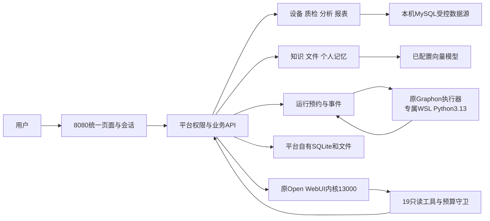
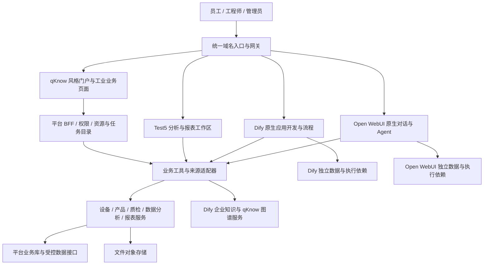
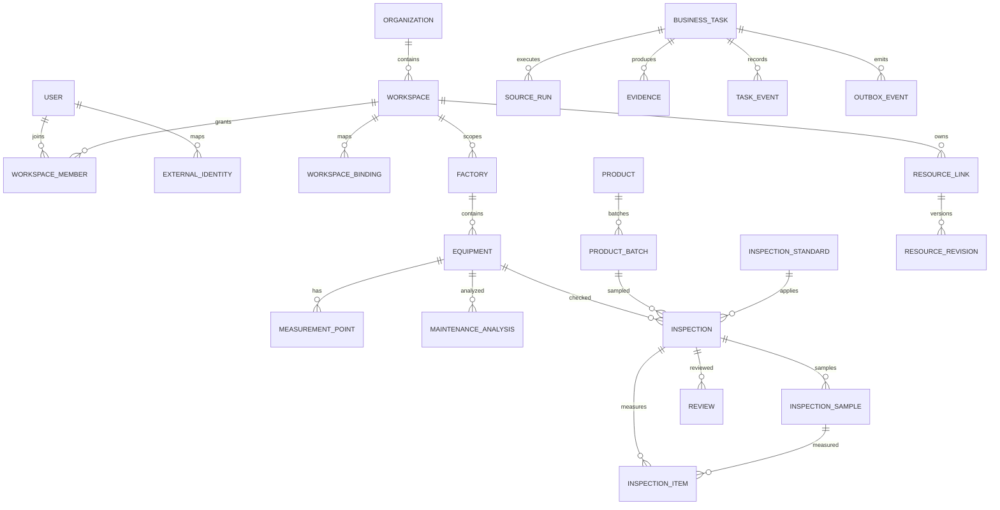
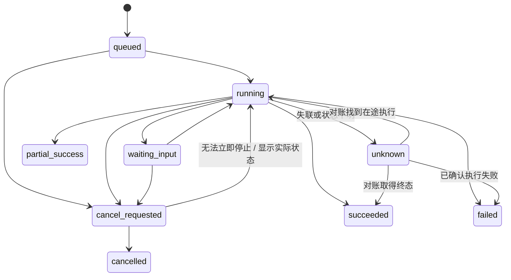
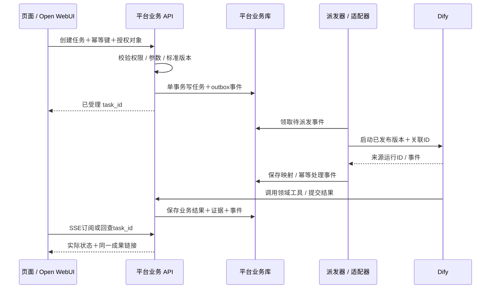

# 架构与实现设计

**读者：全栈开发、架构负责人、测试、运维。** 产品和客户先读 [产品功能与 UX](01_产品功能与UX.md)。本文说明每项能力由谁实现、系统如何聚合、数据如何可信、扩展如何落地。

版本：0.12，2026-10-21；原设计作者：agent-1020-architecture；原任务：T-agent-1020-architecture-01；本轮维护：agent-1020-domain/T-domain61。本文主体保留设计基线；实际代码由root协调实施，差异见以下实现记录及[逐项验收](contracts/实施验收.csv)。设计数量不是实现数量，未压测性能不能写成实际容量。

### 最新决策ADR-08：一个系统融合代码（2026-10-21）

用户已要求在一个系统内融合代码并沿用确定样式。此决策取代ADR-01—06中“多个原生站点跳转即可交付”的接法，完整功能范围不变。平台负责同一登录、工作区、文件、知识来源和任务；优先提取成熟组件与执行器，允许内部独立运行环境，不要求把React/Svelte源码重写为Vue。

当前Windows平台为Python3.14；Graphon0.8要求Python3.12—3.13，因此使用既有专属WSL的3.13解释器，通过受限stdin/NDJSON协议调用原Graph/Engine/VariablePool。纯分支、变量、迭代和循环已验证，平台已接运行预约、结构化输出及TaskEvent；React编辑岛通过Shadow DOM保留原开始/结束/条件节点与条件修改函数，由Vue持有权限和显式revision保存。新建、修改、重开和执行已有真实证据，其余完整原图组件仍在实施；模型、工具、代码、人工节点、触发和Agent循环不能由纯图测试代替。

本轮从原Dify精提`variable-aggregator`节点、面板及分组函数，兼容旧聚合类型，保留分组目标句柄、上游类型与字典nested selector。新增节点ID兼容原变量模板，现有ID、未知字段、只读和revision保护保留；简单local-schema字典字段仍只读，不伪装完整Schema编辑器。190项纯检查通过；两条原Graphon0.8.0聚合图经18HTTP/2次派发实际成功，零值优先、双组输出及保存的分组名/句柄保持，0模型/业务SQL。实际新增聚合UI待验；完整节点保存校验仍需复用原schema，不能调用有初始化副作用的`Graph.init`充当纯校验。

WSL启动归属现由`wsl_identity.py`统一使用内核UUID、PID1原始start ticks与PID namespace摘要；进程记录增加严格的`identity_version=2`及字符串`start_ticks`，原`created_at`仅作审计。191项纯检查通过，11项真实WSL检查在该轮显式跳过；另经受审备份/CAS真实迁移14角色，原PID和cgroup保持，旧keeper归档后创建新keeper，桥11.94秒重绑定通过。旧无ticks记录不自动认领，也不因壁钟变化误判为退出或清理cgroup；历史证据不改写。

平台SQLite已有个人记忆、融合流程预约和知识原件迁移；正式文件保留file_id、SHA、revision与分块位置，读取再次核权限。当前已实测文件上传、17块索引、检索与原件下载。旧Dify/OWUI数据库保留既有原生资源，不后台双写平台的新文档。下文保留的独立原生认证/子域方案仅用于开发与兼容参考，不能作为最新统一体验的完成标准。

原生聊天通过平台普通身份映射访问13000内核，JWT只保存在后台Vault。迁移11记录身份、会话、Turn及动作，迁移12记录附件与原件来源，已经备份升级和结构比对。消息正文与消息树仍由原Open WebUI保存；平台在短事务中预约一次发送，随后经HTTP与Socket收取原事件，最终读取准确助手消息确认完成。同一操作编号不会重复发送，退出页面不等于停止生成；停止结果须核原任务清空。历史与附件读取重新检查当前人员权限，普通用户模型授权使用专属组增量入组，不提升账号角色。

再生成与编辑发送复用同一Turn预约，向原树追加助手分支或用户/助手分支，不原位覆盖旧消息；附件沿准确来源继承、替换或移除。平台确认准确新用户消息已保存后才收起编辑草稿，模型回答失败另存终态。分支与来源边界已有纯回归；50次只读请求验证编辑、取消和刷新，尚未实际派发新分支。

19只读工具已通过专属模型别名、唯一OpenAPI server和当前人员委托接入原工具循环；签名与预算使用受管微补丁，普通模型及原循环保持。原生补丁、能力接口、权限目录和桥已实际安装核验；无预算签名的两条别名请求在派发前403。尚未进行模型选工具的真实调用，具体预算与来源边界见第5.2节。

### 当前实现记录（R22—R24）

前端位于`apps/web`，Vue3/TypeScript模块manifest统一路由与权限；后端位于`services/platform/agent_platform`，入口`main:create_app`，`registry.py`装配模块。质检/样本/维护/查询/报表/实体关系使用独立模型；绑定、目录和配置复用带工作区/可见性/CAS的RecordStore。请求失败先回滚；查询隔离标记通过专用补偿事务写入，不提交半份业务。

本机各执行环境保留独立数据库/目录/回环端口，不继承旧项目环境文件。最新部署为Windows平台和专属WSL，无Docker启动依赖。平台自有SQLite默认用于当前开发；显式升级入口`tools/manage_database.py`只认平台目录内`.sqlite3`，生产不隐式create_all。初始固定结构`20261020_01`后续不得改写，应新增迁移。

质检正式报告由指定不可变InspectionRun生成，标准、结果及准确运行的复核事件在服务端冻结。读取、历史与导出均重查当前来源权限；正文事实只读，改名、刷新审阅快照与发布携带revision。普通报表仍使用自由画布。

合格复核和合格报告发布共用`manufacturing.assessment.has_missing_evidence`，检查缺样本、样本与指标的`incomplete`，避免聚合`failed`遮住缺证据。历史错误合格复核也不能绕过正式发布守卫；历史/草稿读取和不合格报告保留。完整证据的人工改判需留下记录，原run不改写。

维护结果“导出数据”复用`POST /maintenance-analyses/{id}/exports`的真实分组CSV；前端只下载Blob，不重算数据，并处理权限变化、重复点击和迟到响应。35项纯检查通过；本轮实际从1,860条维护观测的4个分组下载415字节CSV，数据与摘要可核。当前没有正式维护报告的生成/发布生命周期。

分析来源维修复核在`manufacturing/maintenance_work.py`读取已保存query并重查当前权限，不再查询业务源。它核对数据源、参数与规范化SQL，拒绝截断或缺来源，逐条核对`recent`时间在`repaired_at`之后且不超过当前时间5分钟，`baseline`可为历史。自动中位分期只在完整且无剔除、重复、冲突时还原；否则要求明确分期。成功快照新增`observation_evidence`保存字段、分期方式、近期数量和起止时间。19项临时库回归通过，已随平台更新部署、迁移仍为head12；部署后真实修后复核尚未验，无接口路径变更。

任务和通知每次读取重新检查当前业务权限；私有原生运行限操作者或获授权运维，签名回调仅修改已经绑定的运行/任务。凭据密文、历史版本、一次轮换票据与短期服务Bearer分别建模；客户端不保存原生管理员Key。平台已在后台完成普通身份映射，统一页面不要求用户再登录13000；企业IdP级SSO仍待接入，不能把身份映射或深链接写成SSO成功。

历史短连通已验证OpenCode Go `deepseek-v4.1-flash`和硅基`BAAI/bge-m3`1024维；本轮唯一新Go回复返回429，未重发。原生Open WebUI使用上游已有custom headers功能，按真实用户/会话传递稳定`x-opencode-session`，不修改消息树。Go地址仍按[当前官方文档](https://opencode.ai/v2/docs/console/go/)的`/inference/go/openai/v1`配置，不因429换成旧Zen路径。短连通不等于RAG/Agent效果或企业多人额度验收。

## 1. 实现原则与架构决策

项目采用“成熟应用完整复用＋制造业业务服务＋统一产品入口”。用户得到一个平台，开发保留清楚的应用边界。

| 决策 | 原因与实现 | 代价、门槛 |
|---|---|---|
| ADR-01：完整保留 Open WebUI 对话和 Agent | 保留 Svelte 前端、FastAPI 后端、消息树、工具循环、子 Agent、审批、附件、记忆及自动任务；通过原生工具接口接业务 | 多一套应用运行环境；微调集中在主题、导航、资源卡片和工具适配，不改写执行内核 |
| ADR-02：完整保留 Dify | 保留 React/Next 前端、Python API、传统 Agent、Agent V2、知识、所有工作流节点、插件、发布和运行能力 | 需部署完整依赖、跟踪上游变更；部分能力是否受授权和特性控制需验收 |
| ADR-03：统一入口采用 Vue 3 | qKnow 的布局与业务组件可以原生适配，Test5 的 Vue 报表模块可提取；不把 Dify/Svelte 强行转成 Vue | 跨应用主题和导航需维护小型集成补丁；完整复用不等于统一框架 |
| ADR-04：业务后端采用模块化 FastAPI | 新增设备、产品、检测、业务任务、资源目录和适配器先在一个业务服务按模块开发；与 Test5 Python 代码迁移接近 | 重型图谱/抽取可先保留独立 Java 服务；不是要求整套 qKnow Java 底座重写 |
| ADR-05：数据库各自负责，跨域走接口 | Open WebUI、Dify、图谱及平台业务各自维护模型和迁移；资源目录只保存关联 | 增加映射和对账，避免共表和直接更新第三方库导致升级失效 |
| ADR-06：统一运行目录，不重造引擎 | 平台记录跨系统业务任务及来源运行号；真实运行仍由原引擎管理 | 状态需适配，不能宣称所有原生任务支持暂停、恢复或取消 |
| ADR-07：首发单企业私有化，组织/工厂/工作区必须隔离 | 数据模型预留企业范围；能力不足时使用独立实例；不把多客户 SaaS 运营作为已确认交付 | 多客户 SaaS 的授权、计费和跨租户运维另定，不影响本次组织与工作区隔离验收 |

ADR-01、02及 qKnow/Test5 复用来源于用户明确要求；具体后端模块边界、部署规格和身份接法是本设计建议。首次技术验证后冻结版本与接法，后续以追加变更记录替代改写已验收结论。

## 2. 原聚合设计与保留的兼容边界

本节图及独立站点路由是ADR-08之前的部署设计，供原生资源兼容使用。新功能按上方统一页面和内部执行协议实现；完整原生能力仍须逐项迁入，不能把本节跳转接法作为最终交付。

**统一的是入口、身份、业务对象、资源导航和证据；原生编辑器、数据库和执行语义保留。** 各服务通过已版本化的接口协作，不能让网页直接访问另一个系统的数据库。

### 2.1 路由、导航与跨应用操作

| 产品逻辑入口 | 原生应用挂载前缀 / 技术映射 | 内容与导航规则 |
|---|---|---|
| `/home` | 门户路由；`/`跳转至本页 | 首页、待办、任务和成果；全局导航＋业务侧栏 |
| `/ai`、`/ai/history`、`/ai/chats/:id/results` | Open WebUI；候选技术挂载为 `/chat/` 或独立子域，由集成验证确定 | 完整对话、历史和成果；全局顶部保留工作区/应用切换，原生会话侧栏保留，不再叠加门户左栏 |
| `/studio/*` | Dify；保留来源路径与内部 ID 的映射 | 完整应用开发、Agent和流程工作区；保留画布、节点、配置和调试布局，只显示一个全局应用切换入口 |
| `/data/*` | 提取后的 Test5 数据源、分析与处理路由 | 普通列表使用业务导航，显示数据范围与指标口径 |
| `/reports/*` | 提取后的 Test5 报表、模板、设计器路由 | 列表使用业务导航，全屏设计器收起业务侧栏 |
| `/knowledge/*`、`/graph/*` | 企业知识与图谱模块路由；Dify编辑页按资源映射打开 | 按工作区和资源权限打开实际模块 |
| `/equipment/*`、`/inspection/*` | 新设备、维护、设备及产品质检业务路由 | 列表、详情、证据与复核保持统一业务导航 |
| 不单列产品页面 | `/api/v1/`为平台 BFF 与业务接口；原生接口经各挂载规则隔离 | 不与原生应用的 `/api` 路由混用 |

逻辑入口是功能与页面统计的正式口径；技术挂载只解决静态资源、原生路由和反向代理，不增加一套用户菜单或重复页面。`/chat/` 是候选技术位置，不是另一个 AI 产品入口。平台负责把逻辑深链接与来源 chat/app/run ID 映射；浏览器前进后退、刷新和分享链接的行为必须在集成验证中确定。

同源路径是首选部署目标，**必须先通过真实构建验证**。Open WebUI 静态资源、前端路由、API、Socket.IO/WebSocket 路径，Dify 的 basePath、前端资源、控制台/API/上传/回调地址必须同时匹配。不能只在 Nginx 上剥掉一个前缀，也不能靠全局字符串替换 HTML/JS 拼接。

若目标版本不可靠支持子路径，发布前采用 `chat.<企业域名>`、`studio.<企业域名>` 等独立应用域名＋统一身份作为正式替代；在同一浏览器标签内跳转并保留返回入口。此时不声称同源，明确配置 CORS、回调地址和每个应用独立 Cookie。**不以 iframe 作为默认集成方案**；它会增加登录、焦点、下载及流连接的复杂度。可嵌入的单个成果另按授权与内容隔离处理。

网关对流式接口关闭缓冲，配置合理空闲超时与心跳；转发 WebSocket Upgrade；下载和大文件上传设置独立限制。连接中断时前端回查已存在运行号，不能再次提交同一业务动作。对每个子系统验证刷新深链接、前进后退、上传、导出、SSE、WebSocket、退出和工作区切换。

### 2.2 统一身份与权限

身份服务是平台用户、组织、工厂与工作区的管理入口；每个原生应用仍使用自己的有效用户和授权模型。

1. 浏览器仅持有所属应用的安全会话 Cookie；BFF 统一校验平台身份。Cookie 使用 Secure、HttpOnly、合适的 SameSite；写操作有 CSRF 防护，跨域接法单独评估。
2. Open WebUI 源码已有 OAuth、LDAP、可信头等入口。优先对接已核验可用的标准身份提供方；使用可信头时，入口必须先清除外部同名头，只有受信代理能签发，应用端口不可绕过代理公开。这与官方 [SSO](https://docs.openwebui.com/features/authentication-access/auth/sso/) 及 [部署加固](https://docs.openwebui.com/getting-started/advanced-topics/hardening/) 要求一致。
3. **Dify 当前版本不能预先假设社区控制台已支持所需 OIDC/SSO。** 先核验许可、原生认证和工作区成员能力；标准接法不可用时，用受审计的最小认证扩展桥接平台身份与真实 Dify 账户/会话。身份接入未完成就不能宣称一次登录已验收，不能伪造任意用户或共享管理员 Cookie。
4. `external_identity` 保存平台用户与来源用户映射；`workspace_binding` 保存平台工作区与 Dify tenant、Open WebUI group/资源范围的映射，包含同步状态与最后核对时间。来源没有等价隔离能力时，以独立实例或受限入口补足，不能把 group 当作天然多租户边界。
5. 角色只决定“可做什么”，数据范围另决定“可操作哪些工厂、设备、数据源和文档”。BFF 校验入口权限；来源适配器和业务服务再次校验资源权限，防止改 URL 越权。
6. 后台任务保存发起人、执行主体、工作区和授权范围。服务身份使用独立最小权限凭据及可追溯的委托上下文，不使用平台管理员身份代替全部用户。Dify 应用 API Key 若是应用级权限，应在适配层先校验用户可用该应用及数据范围，再调用；它不等价于用户身份。
7. 离职、角色撤销和工作区禁用应停止新执行与下载授权。后台任务执行关键步骤前重新检查；是否终止已启动外部动作按业务策略记录，不能只隐藏页面。

## 3. 各模块如何实现

以下编号与功能基线一致；“复用”均包含必需依赖和权限链路。

| 模块 | 实现归属与具体方式 | 主要依赖 / 交付对象 |
|---|---|---|
| M01 首页任务 | 新门户汇总真实待办、最近资源、原生运行映射；按岗位显示快捷入口 | 任务目录、权限、来源状态；可打开同一 `task_id` |
| M02 AI 对话 | Open WebUI 原生应用；通过 OpenAPI/MCP/工具扩展调用领域服务；成果卡展示业务 ID、版本、来源和入口 | 原生消息树、工具审批、子 Agent、文件与流事件 |
| M03 Agent 应用开发 | Dify 新旧 Agent 完整保留，Open WebUI Models/Agent 同时保留；平台目录标注来源与调用方式 | 两类配置与版本分别存储，Dify Agent V2 不转换为 legacy strategy |
| M04 工作流自动化 | Dify 原生画布、节点、变量、迭代、人工输入、调试、发布和触发；固定质检/处理提供业务模板 | worker、beat、websocket、插件、sandbox、Agent 运行组件 |
| M05 数据源语义 | 提取 Test5 数据源与授权查询；新增指标口径、单位、时区、表字段说明与工厂范围 | 凭据服务、只读连接、SQL 安全验证、元数据快照 |
| M06 数据分析处理 | 提取 NL2SQL、AST 校验、受控查询和质量检查；Dify 编排批处理；稳定计算用领域代码完成 | 参数化查询、查询预算、数据血缘与处理版本 |
| M07 报表大屏模板 | 迁移 Test5 Vue 设计器、查看器、组件目录、20 模板与关联资源；保存结构化布局及绑定 | 图表/地图/字体、图片、组件版本、模型生成、受控查询 |
| M08 知识文档 RAG | 平台管理正式原件、分块与来源；提取已有解析/检索实现，Dify RAG Pipeline仍需融合 | 原件SHA与版本、片段ID、检索分数、原文定位与ACL |
| M09 本体抽取图谱 | 优先提取 qKnow 已有本体、映射、抽取、图谱与 Java 服务；补齐实际缺口，Dify 调专用任务接口 | 图存储选型和服务依赖依据 qKnow 部署核验，不预装无关图数据库 |
| M10 设备维护预警 | 新业务实体与接口，qKnow 风格页面；设备类别 Skill 调数据计算＋资料检索＋维修记录 | 测点、工况、单位、告警去重、分析证据、处置记录 |
| M11 设备及产品质检 | 设备点检与产品/批次质检分别建模；Dify 模板调用数据、视觉/规则检测；人工复核落库 | 标准版本、原始样本、检测结果、复核人与不合格处置 |
| M12 工具 MCP 技能插件 | 保留 Open WebUI 与 Dify 原生扩展功能；平台注册表列来源、版本、输入、权限及执行风险 | 插件隔离、凭据、网络白名单、工具调用追踪 |
| M13 应用行业方案 | 新增真实应用目录、发布版本、绑定资源与安装配置；食品、化工、纺织用行业包交付 | 目录、Agent/流程/知识/报表版本引用，不复制用户密码 |
| M14 用户组织权限 | 新平台身份和组织；映射原生账户、成员与资源授权；统一审计 | 工厂范围、RBAC、数据权限、认证适配器 |
| M15 模型凭据 | 平台登记供应商和用途，密钥加密；通过受控适配配置到原生提供商；保留各自模型参数 | 对话/向量/视觉/rerank/语音能力矩阵、配额与配置校验 |
| M16 运行运营系统 | 业务任务投影＋原生运行详情；Open WebUI 自动任务和 Dify 触发均保留；统计从事件生成 | trace_id、运行号、日志脱敏、健康/成本/失败指标 |
| M17 文件文档成果 | 统一资源目录和授权下载；原始文件/检测图/报告/报表分别存版本；原生附件保留 | 对象存储、内容哈希、短期下载地址、模板化文档导出 |

动态分析由 Open WebUI 主导；固定流程由 Dify 主导。一次业务任务记录一个主执行器。需要调用另一侧 Agent 时当作明确子任务，设置调用深度、时间、token 和工具次数预算，防止互相递归。

## 4. 数据边界与数据库设计

### 4.1 谁是事实来源

| 数据 | 权威来源 | 平台保存内容 |
|---|---|---|
| 融合会话与消息 | 原Open WebUI自有数据库 | 平台保存普通身份映射、会话/Turn、动作、来源和Task；原树保存正文，浏览器草稿不作为正式会话事实源 |
| 个人记忆 | 平台按用户与工作区隔离的记忆表 | 分页、搜索、CRUD与revision；默认不自动采集或注入，显式对话选用仍待接入 |
| 融合工作流与正式知识 | 平台模型、迁移和原件存储 | 定义快照、预约/运行/事件、文档分块与固定来源；图执行由原Graphon负责 |
| 原生既有会话、应用、知识和运行 | 原Open WebUI/Dify实例 | 保留原资源ID/映射与独立数据；显式迁入前不双写、不直接改内部表 |
| 本体、实体关系、抽取结果 | qKnow 图谱模块 | 来源文档/片段版本与实体引用、业务对象关联 |
| 设备、产品、批次、检测、复核、维护处置 | 平台业务库 | 完整领域数据与不可变证据引用 |
| 报表、模板、布局和数据绑定 | 提取后的报表模块 | 正式 report/template ID、revision、组件协议与生成记录 |
| 历史指标与生产记录 | 企业已授权业务数据源 | 元数据、查询记录与必要结果快照；不默认复制整个生产库 |

**新增融合模型由平台迁移统一管理，保留的原生实例不直接共写这些表。** 当前平台存储与用户两个MySQL业务源分离；源数据通过授权查询或本次明确的数据导入进入独立新表，不覆盖旧业务。生产存储按负载和备份边界选择，不为技术完整同时部署多套同类服务。

演示导入按原计划、来源SHA和连续批次账本复核后续写，不重放已提交行。连接前预检PyArrow/pytz实际转换依赖；失败只记录异常类型、数字errno和脱敏位置，不保存SQL、参数或locals。27项纯回归通过；受审恢复已核原1,483,000行/1,625批并续导857,740行，主包共2,340,740行，单连接/6,506条SQL/1,172.311秒完成；食品三维样本另16行。两个本机源、9设备/测点已登记，三业务真实受控读取成功；所有数据标记synthetic，原业务表不覆盖，不能当成企业故障预测或质检准确率验证。收据与失败历史见[共享进度](../需求梳理/PROJECT_STATUS.md)。

### 4.2 平台业务库概念 ER

ER 表示核心关联，不是全部字段的建库 SQL；`INSPECTION` 用对象类型和约束保证一次记录关联设备或产品批次中的一个，不允许同时混填。实施时按功能需求生成迁移并随代码评审，禁止先手工改库后补记录。

| 表族 | 最小关键字段与约束 | 检索 / 并发设计 |
|---|---|---|
| user / organization / workspace / membership | UUID 主键、状态、角色与数据范围；成员唯一 `(workspace_id,user_id)` | 组织和状态索引；停用不物理删除已签名业务历史 |
| external_identity / workspace_binding | source_system、source_instance、external_id、subject_id、mapping_status；外部身份组合唯一 | 不能只按邮箱/显示名匹配；映射变更审计 |
| resource_link / resource_revision | kind、owner_workspace、source_system、source_id、source_version、acl_ref、content_hash；来源组合唯一 | 工作区＋类型＋更新时间索引；版本记录追加，更新用 version/ETag |
| business_task / source_run | requester、executor、task_type、status、source_run_id、idempotency_key、input_ref、workflow_version、last_event_seq、error_code | 工作区＋状态＋时间、来源运行号唯一；幂等键按工作区＋动作作用域唯一；同键不同输入报冲突 |
| equipment / measurement_point | 工厂、设备编码、设备类别、型号、测点编码、物理量、单位、有效时间 | 设备编码工作区内唯一；测点同设备内唯一；不把时间序列逐点塞设备 JSON |
| maintenance_analysis / alarm / disposition | 设备、分析窗口、工况、规则/Skill版本、证据、置信说明、建议、责任人、处置状态 | 设备＋时间索引；告警用规则＋对象＋事件窗口去重；处置状态保留历史 |
| product / product_batch / inspection_standard | 产品编码、批次编码、标准编号/版本、适用范围、生效时间、审批人 | 产品/批次按工作区编码唯一；已使用标准不可原地覆盖 |
| inspection_sample | inspection_id、sample_code、sampled_at、quantity、unit、附件引用及可选external_ref | 样本编码在任务内唯一；继承任务的工作区/批次；检测结果必须引用该任务下样本 |
| inspection / inspection_item / review | 对象、批次/设备、任务、样本、标准版本、实测值/单位/缺陷、判定、reviewer、decision、review_version | 复核与并发更新乐观锁；实测值及原判定追加证据，复核不改原始值 |
| datasource / semantic_metric / query_record | provider、endpoint_ref、credential_ref、允许表字段、指标公式/单位/粒度、查询hash、预算/耗时 | 数据源和指标版本化；原始密钥、全量敏感结果不写查询日志 |
| report / report_revision / template | 布局协议、组件目录版本、数据绑定、生成版本、来源模板、已发布版本 | 发布引用固定 revision；草稿自动保存有并发检查，不能覆盖他人版本 |
| evidence / file_asset | source_id/version、对象键、hash、mime、size、classification、retention_until、legal_hold | 工作区 ACL＋下载检查；对象键不等于公开 URL |
| outbox_event / callback_receipt / audit_event | event_id、aggregate_version、schema_version、payload_ref、dispatch_state；回调来源＋事件号唯一 | 状态＋下一次投递时间索引；审计追加写，访问凭据脱敏 |

所有业务时间内部存带时区 UTC，页面默认 Asia/Shanghai；生产统计按工厂班次与业务时区计算。数值保存单位、精度和缺失标识；“缺数据”“执行失败”“待复核”和“不合格”是不同状态。涉及金额、成分和计量使用合适 decimal 精度，不能用展示格式代替业务值。

**保留与加密建议：** 密钥采用服务端加密＋独立主密钥或企业密钥服务，平台表只留凭据引用；传输走 TLS。原始附件和检测证据的保留期由客户质量管理规则确定，未确定不自动清理。运行明细建议先按 90 天热数据、后续归档设计；审计建议至少 180 天在线可查，这两项是容量假设，需客户确认。删除流程先检查引用、保留期与保全标识，删除后写审计；备份保留及恢复演练纳入运维验收。

## 5. 任务、事务与失败处理

平台只统一业务可理解的状态，不抹平原生差异。

`partial_success` 表示已有可使用成果且另有步骤失败；`unknown` 不能显示成功或擅自重跑。质检任务运行成功后仍可能是“待复核/不合格”，运行状态与业务判定分别保存。

| 来源情况 | 平台处理 |
|---|---|
| Dify 草稿/发布运行、Agent 与工作流运行 | 保存来源类型、run/task ID、应用及实际版本；适配运行事件与状态；人工输入映射 waiting_input |
| Open WebUI 对话/工具/子 Agent | 保留 chat/message/task/tool_call ID；对话流结束不自动代表所有后台子任务结束 |
| 取消 | 先记录请求，再调用原生停止接口；只有确认停止才标 cancelled；已完成外部业务写入不会假装撤回 |
| 恢复 | 优先回查原运行与成果；来源明确支持续跑才提供“继续”；否则“重新执行”生成新任务，关联原任务并要求明确操作 |
| 实例重启 | 扫描未终态目录，查询来源状态；不能声称所有内存中的 Agent 推理可从中间点恢复 |

### 5.1 跨库不使用伪原子事务

单库事务内写任务与 outbox；派发采用领取锁/租约。对外部引擎必须区分“已确认未送达”和“可能已受理”：后者先按关联 ID 对账，**不能因响应超时直接再次启动流程**。若来源没有幂等启动或可靠关联查询能力，进入待核实并提示人工处理，这属于集成验收门槛。

回调验证签名、时间窗和来源，按事件 ID 去重；事件乱序以来源序号/版本处理，终态不被旧 running 事件覆盖。若原生系统没有合适回调，使用其受支持的事件流或有限频次回查，不虚构 webhook 能力。对账器只读比较任务与来源状态，修复投影并写审计，不修改来源内部表。

数据库超时、连接中断、资源异常、业务标准缺失和权限错误都进入明确失败/待处理；停止该批后续查询，核对在途工作，不自动扩大超时、换源或重试。网络类可重投事件仅在确认幂等、预算与故障分类策略后开启；每次记录次数与原因。测试中的异常处理继续遵守用户的本地数据库边界。

### 5.2 原生对话工具预算与可信委托

实现入口为`chat/native_tool_policy.py`、`native_tool_budget.py`、`integrations/delegated_*`及`deploy/native/owui_*_patch.py`。普通对话沿原模型路径，专属别名才启用固定19个只读操作：15个制造/报表读取，加4个已保存查询与知识操作。它们不执行新SQL、不修改质检或报表。

| 边界 | 当前实现 |
|---|---|
| 人员与权限 | 工具服务身份、原OWUI签名用户、准确活动Turn三重关联；重新加载人类成员/角色，取人类与服务身份权限交集；不用模型参数充当身份 |
| 签名与预约 | 独立HS256预算签名绑定用户、工作区、实例、原chat/用户/助手消息、别名、server、最终请求SHA和原deadline；首次与每次批准恢复消费唯一nonce |
| 双侧计数 | 平台在业务读或embedding前通过短事务CAS消费工具额度，失败不退；原生独立账本累计工具轮次和实际上游模型请求，包含上下文压缩，同批审批恢复不重复计轮 |
| 上限 | 默认4次工具、2轮、3次模型、90秒；每次模型输出沿预约token上限，不能将其称为累计token计费。恢复不延长原截止，普通模型不改全局256轮配置 |
| 来源 | 已返回项冻结来源并在历史、继续、分叉和工具返回前重查；已保存查询校当前行列范围，知识校文档/原件版本与撤权。列表只返回本页items和已返回条数，不泄露未返回项统计 |
| 新存储 | 仅OWUI自有DATA_DIR下`aic-native-turn-budget.sqlite3`保存摘要、nonce和计数；不写`webui.db`业务表，不保存正文、密钥或JWT |
| 受管部署 | 工具签名与预算密钥分离，非密文配置固定运行根/别名/server，启动核源码SHA与桥归属。仅固定本机工具连接转发签名，全局用户转发保持关闭 |

原生`GET /api/aic-native/budget`使用官方用户认证，只返回版本、patch_id、别名、server和ledger_ready；平台派发前必须核完全匹配。四处预算补丁分别落在`main.py`、`utils/chat.py`、`utils/middleware.py`和`routers/openai.py`，工具头补丁只改`utils/tools.py`受管连接分支。升级先核锁定版本与原/补丁摘要，未知版本拒绝安装，不做模糊替换。

桥生命周期只对准确的所属launch重新绑定当前平台和OWUI，身份或挂载不明不接管。当前8.61秒重绑定保留已有14个WSL角色；整机冷启动、NAT变化和完整恢复仍需另验。预算安装/目录读回及两条未签名403已经实测，计数均保持零；没有真实模型工具调用或回答质量证据。

## 6. 知识、报表与工业分析的实现细节

### 6.1 企业知识只维护一份正式来源

新正式文档经平台知识接口上传，复用统一文件存储；记录文档与原件ID、SHA、revision，分块保留页、段落、表格或行位置。解析提取Test5已有实现，向量使用配置的bge-m3；文件与预约先提交，解析/索引失败留下可回查记录，只有ready文档参与检索。图谱、Agent和流程引用同一文档版本，不另建一份暗中双写的正式来源。

原生附件和已有Dify资料保留原归属；进入融合知识库是显式导入操作。通用文件入口、知识下载和历史引用均重核当前权限及固定来源版本，不能凭file_id绕过。个人记忆已按用户和工作区隔离，但自动采集和注入对话尚未完成。完整RAG Pipeline、多版本索引切换和OCR仍是后续能力，不以当前文本索引冒充已交付。

### 6.2 Test5 提取为可独立运行的分析与报表模块

1. 迁出 Vue 分析页、设计器、查看器、组件库和完整静态资源；保留已有布局/组件协议及20套模板映射。33份来源报表快照按资产类型单列，不算入20套模板。
2. 迁出 analytics 的数据源、NL2SQL、SQL AST 安全、字段授权和查询预算；保留 reports 的生成、绑定、验证、版本、模板和恢复模块。
3. 把原宿主的 Context、权限、workspace、provider、文件、运行记录和幂等依赖替换为平台适配接口；不把 DSH/旧聊天宿主再带入。
4. 前后端组件目录当前口径不同，迁移前冻结可渲染类型与 schema，逐项登记版本。参考图裁片组件要分别验收原样本视觉和新数据重绘效果，不能用缩略图代替真实绑定验收。
5. Open WebUI 与 Dify 调用同一查询/报表 API，结果返回 report_id、revision 和受权入口；聊天解释、报表详情和设计器打开同一资源。

当前“NoSQL”按资产证据实现为**免写 SQL 分析/受控 SQL 查询**；原生 MongoDB/InfluxDB 查询没有核验证据。未来要增加时按数据连接器扩展，不能在现版本能力表写成已支持。

### 6.3 制造业可信输出

设备维护分析先识别设备类别和工况，按授权窗口取得测点，代码计算缺失率、统计量、趋势和异常，再检索设备资料、维修案例与类别 Skill，输出带证据的分析。遵守历史要求，不默认训练预测模型，不把合成样本的效果写成生产准确率。

批次由平台批次目录登记并返回ID，样本在质检任务下登记并返回ID；分别对应 `/product-batches` 与 `/inspections/{id}/samples` 契约。可手录或受控导入，`external_ref` 只绑定已授权来源和稳定记录，不代表已接通MES。产品质检每任务固定单一产品批次；样本继承其范围，附件不能代替样本登记。

产品质检先固定产品/批次、标准版本和样本；规则检测、算法/视觉模型、人工复核分别保存实测结果与证据。LLM 用于理解、调用和解释，数值判定与标准比较用可复算代码。缺样本、单位不一致、检测超时返回待处理；不能写成合格。复核要记录原结论、改判原因与责任人。

设备接入以客户现有数据库/接口为起点；OPC UA、MQTT、PLC 写入等若后续需要，作为独立适配和授权范围。默认平台输出建议、工单与提醒，不自动启停设备；实际控制必须另有权限、工艺联锁、审批和现场验证方案。

## 7. 接口、适配器与外部调用契约

平台接口使用 `/api/v1`；实际联调使用 [代码OpenAPI](contracts/platform.openapi.json)。[设计OpenAPI](contracts/openapi.json)、[接口目录](contracts/接口目录.csv)及[接口基线](contracts/接口基线.json)保留设计范围和归属映射，设计登记不等于实现验收。原生 Open WebUI、Dify API 不强行改名或全部包成一次转发；只对业务需要提供稳定适配。

| 契约 | 规则 |
|---|---|
| 标识与关联 | 平台 ID 与来源 ID 分开；请求携带 trace_id/request_id；关联用户、工作区、来源实例和实际版本 |
| 长任务 | 创建返回 202＋任务资源；可独立查询状态、事件和成果；不能长时间占住一次 HTTP 请求等待全部处理 |
| 幂等与并发 | 业务创建动作接收幂等键；相同键/参数返回同一资源，不同参数冲突；编辑使用 revision/ETag 防覆盖 |
| 分页与错误 | 列表有上限、分页与稳定排序；错误给 code、可读中文 message、request_id、可处理建议；不返回堆栈/密码 |
| 文件与成果 | 上传校验大小/MIME/哈希；下载重新授权；工具返回引用与摘要，不把超大文件塞入模型上下文 |
| 工具输入 | schema 描述必填、枚举、单位和边界；禁止模型传入任意数据库地址、自由凭据或绕过授权的表名 |
| 版本 | 外部接口与事件 schema 版本化；默认新增可选字段；破坏兼容创建新版本并写迁移窗口 |
| 外部调用 | 在功能基线登记调用方、用途、认证、网络方向、配额和负责人；Webhooks 验签、防重放，回调不能任意访问内网地址 |

建议把 `TaskAdapter`、`KnowledgeAdapter`、`ReportAdapter`、`IdentityAdapter`、`ModelAdapter` 作为薄接口，负责协议与状态转换。领域规则留在领域服务；不在适配器复制质检标准和权限算法，也不把所有系统接口压进一个巨型网关函数。

## 8. 以后增加功能：能耗异常分析完整示例

假设客户新增“比较同类设备在相同产量/工况下的电耗，发现异常并生成建议”。这是 M10/M06/M07 的扩展，可使用现有 Agent 和流程能力，不需要再写 Agent 内核。

| 开发环节 | 本次需要增加的内容 | 完成证据 |
|---|---|---|
| 需求与范围 | 定义电量/产量/工况、时间窗、基线、缺失数据、异常口径和建议用途；区分功率 kW 与电量 kWh | 产品验收例：已知样本输出预期设备、偏差和缺失提示 |
| 实体与迁移 | 新增 energy_analysis、baseline_revision 或复用版本化分析模型；引用设备/测点/指标版本，不新增重复设备表 | 可回滚迁移、唯一业务键和工作区范围索引 |
| 权限 | `energy.analysis.read/run`；限定工厂/设备/数据源；定时任务用受限服务身份 | 越权设备无法查数，也无法通过工具旁路 |
| 业务 API | 在既定接口风格下增加分析创建、详情、证据与重新执行；长任务遵守202及幂等契约 | OpenAPI、请求/响应样例、错误码和调用方登记 |
| 计算与数据 | 参数化取得电量/产量，统一单位和工况；确定性计算单耗、基线和偏差；返回数据质量 | 固定样本复算一致，零产量/缺测/时间重叠有明确结果 |
| Open WebUI 工具/Skill | 注册 `analyze_equipment_energy`，输入设备ID/时间/基线，输出 task_id、证据和报表；按设备类别配置 Skill | 对话能澄清设备、提交一次、追问同一结果，停止不假成功 |
| Dify 模板 | 新增“每日能耗检查”模板：输入→取数→质量判断→计算→知识建议→报表→人工确认/通知 | 手动和定时独立运行；失败分支、不重复通知有记录 |
| 页面与报表 | 能耗分析列表/详情放设备模块，趋势/偏差/证据表；复用报表组件和模板，不复制设计器 | 业务页和聊天打开同一任务及报告，空态/错误态完整 |
| 测试与部署 | 单元测试计算；契约测试适配；本地授权数据小范围集成；特性开关按工作区启用 | 基准样本、权限/并发/失败/恢复用例通过，数据库测试目标已核实 |
| 回滚与兼容 | 保留旧 API/流程版本，关闭新入口和触发；在途任务按原版本结束或明确取消；保留已有结果 | 回滚演练可读旧报告，旧客户端缺省字段仍正常 |

功能包的最小交付内容是：需求编号、数据库迁移、接口与事件 schema、权限、工具定义、页面入口、Dify 模板/Agent 配置、示例数据、测试、监控指标和部署开关。配置包只引用密钥，不携带密钥原文。插件/行业包有版本与依赖清单；安装先检查依赖，升级不原地覆盖已发布流程，卸载先检查在途任务和被引用资产。

## 9. 环境、部署与容量设计

### 9.1 部署单元

| 单元 | 开发环境 | Linux 私有化生产 |
|---|---|---|
| 入口与门户 | 本地前端开发服务＋网关；每个应用独立端口 | Nginx/等效网关＋版本化静态资源，统一 TLS |
| 平台业务与报表 | FastAPI 分模块；本机受控数据库；本机对象存储 | API 与任务派发进程分开；持久卷/对象存储；有备份恢复 |
| Open WebUI | 固定源码与依赖，独立数据库；按需启用终端 | 原生运行依赖完整部署；终端/代码执行单独隔离 |
| Dify | 本机独立Python/Node环境与新PG/Redis/Qdrant，使用deploy/native入口 | 原生api、web、worker、定时/事件、plugin_daemon、agent_backend及sandbox等依赖分别安装与托管；完整功能按锁定版本核验 |
| qKnow 图谱抽取 | 必需 Java 模块独立运行，先验证实际依赖 | 图谱服务隔离部署；只保留被选模块及其确证依赖 |
| 模型 | 用已配置且获准的对话/向量/视觉模型 | 本地模型或明确授权的模型服务；敏感数据去向按企业规则配置 |

历史R25—R27曾允许并尝试D盘Docker，后被用户明确的Windows本机启动与既有WSL复用要求取代。当前日常入口使用`deploy/native/desktop.py`：Windows平台和完整Open WebUI、专属WSL keeper；不依赖Docker。Dify专属WSL已完成迁移及14角色运行，代码节点、发布调用及知识检索已有实际证据；日常启动不会重新拉起全部角色。Agent V2、全部节点与整机冷启动仍须分别验收。旧Docker排障资料只作历史记录，不能作为当前部署前置。

以下是完整平台的采购/验证起点，**不是压测结论，也不是 Dify 单项目最低要求**：

| 档位 | 建议起点 | 验证负载目标与限制 |
|---|---|---|
| 开发验证 | 8核、32GB内存、SSD 200GB，模型外置 | 单开发/测试人员并行少量任务；图谱和重索引按需启停 |
| 工厂试点 | 16核、64GB、SSD 1TB，模型独立 | 30个登录用户、5个同时对话、2个固定业务任务作为首轮容量验证目标 |
| 多工厂扩展 | API/worker横向拆分、数据库/对象存储独立，至少先按试点瓶颈评估 | 并发、数据保留和模型token吞吐实测后定规格；不按用户总人数直接估算GPU |

模型 GPU、向量索引及视觉样本会显著改变资源需求，单独测量。在约定浏览器、局域网、数据规模、冷/热缓存和并发下，常用列表与详情 API 目标 P95 ≤2秒，首屏主要内容目标 ≤3秒；业务受理接口另设 P95 ≤1秒的子指标，用户发起操作后2秒内应看到已受理、排队或明确错误。模型首 token、复杂分析与报表生成单独记录，不把外部模型耗时混入普通接口，也不能用空接口达标代表 AI 任务达标。每次性能报告写硬件、模型、数据规模、并发和分位数，先小范围检查，不默认压测现有数据库。

### 9.2 上线必须具备的运行能力

- 配置按环境分离，运行包、依赖锁、数据库迁移、应用/流程/组件模板版本可追溯；没有开发机转发和个人桌面服务依赖。
- API/worker 分开健康检查；就绪状态检查必要依赖，避免仅网页200就判健康。索引/图谱可降级时明确哪些功能不可用。
- 统一 trace_id 关联网页、Open WebUI 工具、Dify 运行、业务查询和报表；日志屏蔽密钥及敏感原文。
- 指标覆盖失败率、等待时长、运行时长、token/费用、查询耗时、队列长度、存储增长、取消失败和未对账任务。
- 网络默认限制到必要内部服务，模型/插件外联名单明确；sandbox/终端不能直接取得数据库管理员凭据或访问设备控制网。
- 备份包括平台与原生系统数据库、文件、索引重建依据、加密密钥恢复方案；恢复演练验证资源映射和已发布版本仍可用。

## 10. 技术验证门槛、待决项与来源

| 项目 | 明确完成条件 | 未完成时的处理 |
|---|---|---|
| 登录与导航 | 真实用户跨应用登录/退出、工作区切换、无双重导航、刷新深链接通过 | 保持独立原生登录用于开发，不宣称统一体验交付 |
| 路由与连接 | 子路径或子域方案通过上传、下载、SSE/WS、回调和 Cookie 测试 | 在首个集成里程碑固定可行接法，不能拖到上线 |
| 身份和资源范围 | 越权请求被各层拒绝，服务身份最小授权，撤权生效 | 不能用共享管理员 Key 作为正式交付 |
| 运行一致性 | 超时未重复启动、回调幂等、取消真实、断线回查、重启对账通过 | 显示待核实/失败并保留人工处理入口 |
| 数据与模板 | 指标口径、标准版本、20模板及组件数据替换验收通过 | 精确登记缺口，不以参考图或合成数据替代业务效果 |
| 授权与品牌 | 核对固定版本 LICENSE、商业部署范围、Logo/归属和插件许可 | 先保持原声明，按取得授权确定品牌微调和交付范围 |

尚需冻结：客户规模与行业优先顺序、是否跨法人多租户、实际模型与数据敏感等级、正式身份提供方、数据保留期、原生应用品牌处理。它们不阻塞文档与适配器开发；涉及的采购、认证和对外发布必须在对应里程碑前确认。

**本地证据入口：** [四项目综合盘点](../需求梳理/四项目复用核查与历史需求总表_20261020.md)、[Open WebUI专项](../需求梳理/OpenWebUI_功能与界面核查_20261020.md)、[Dify专项](../需求梳理/Dify_功能与界面核查_20261020.md)、[qKnow专项](../需求梳理/qKnow_功能与界面核查_20261020.md)、[Test5专项](../需求梳理/Test5_功能界面与报表资产核查_20261020.md)。这些报告包含实际源码路径和静态验证范围。

关键实现依据为 `open-webui-main/backend/open_webui/utils/middleware.py`、`utils/subagents.py`、`routers/auths.py`、`utils/access_control.py`；`dify-main/web/features/agent-v2/AGENTS.md`、`api/controllers/console/app/workflow.py`、`api/services/trigger/` 与 `docker/docker-compose.yaml`；Test5 的 `analytics/sql_safety.py`、`reports/generation_bindings.py`、`JimuReferenceWidget.vue`；qKnow 的 `views/ext`、`views/app/graph` 和对应 Controller。它们支持复用设计，不证明跨项目联调已通过。

**官方补充资料（2026-10-20核阅）：** [Dify Docker Compose部署](https://docs.dify.ai/en/self-host/deploy/quick-start/docker-compose)列明原生服务与依赖，当前整合设计按固定本地版本核对；[Dify工具插件开发](https://docs.dify.ai/en/develop-plugin/dev-guides-and-walkthroughs/tool-plugin)提供工具封装与授权扩展入口，工业工具仍需实现自己的业务权限与契约。官方部署最低规格只适用于其说明范围，不作为本平台容量承诺。

本轮只读核查并编写文档，没有连接数据库、启动模型或服务、修改业务代码；上述性能、恢复、安全和完整页面目标均待后续按 [开发计划与验收](03_开发计划与验收.md) 实测。
