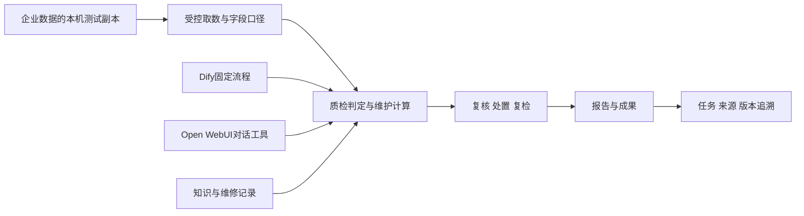

# 开发计划与验收

版本：0.12，2026-10-21。原作者：agent-1020-delivery；本轮维护：agent-1020-domain/T-domain61，实际验收由root协调。状态：**本机数据演示通过，单系统完整功能与企业验收仍在实施。**

### 当前验收入口

- 最新交付方式为8080同一系统：统一页面、身份与业务资源，内部复用原生执行器。独立原生站点已运行属于复用基础，不代表对应功能已迁入；原125项范围不缩减。
- 最新已验：个人记忆7次管理API与真实表单；两步文本工作流7次API、同键只有一次运行；知识CSV上传/17块索引/来源行号/原件SHA下载/检索，7次本机API、2次bge-m3请求。平台10迁移前已备份并完整比对模型结构。
- 本机MySQL主包2,340,740行已完整导入：食品779,949行，化工纺织1,560,791行；食品三维质检另16行。受审恢复先核原1,483,000行/1,625批，再续857,740行，1连接/6,506条SQL/1,172.311秒完成，原批次不重写；失败历史保留。26次平台HTTP登记2数据源、9设备/9测点，设备/维护与产品两阶段分别7次和9次HTTP、3次和2次受控源读取，单查询2秒限制。均为合成演示，旧业务表保留，不代替企业数据验收。
- Graphon0.8纯节点已接平台并通过实际分支、结构化输入输出、节点事件及同键复用验收；首批3种节点编辑岛已有37次同源请求的新建、修改与重开证据。原Dify变量聚合复用通过190项纯检查，本轮两条固定聚合图以18HTTP/2次派发实际成功，零值优先、双组输出和保存的组名/句柄正确，0模型/业务SQL。新增聚合UI编辑及完整节点、容器、调度和Agent V2仍待验。
- 平台独立备份后更新，迁移保持head12且结构一致，T52修后观测检查已部署。WSL身份改为原始ticks，191项纯检查通过、11项真实WSL检查在该轮跳过；随后真实备份/CAS迁移和桥11.94秒重绑定成功，14角色原PID保持，0角色重启/数据库请求。整机冷启动仍未验。原生普通身份、同键会话与附件的既有实际证据保留。
- 同页Svelte聊天组件已通过50次只读/登录请求，原消息、模型、附件、可用输入和刷新恢复均有实际截图。原自动滚动的循环更新问题已修，并补1页/0HTTP的真实浏览器回归。本轮唯一新Turn及同键复用成功到达原内核，Go上游返回HTTP429/端点不可用，准确助手失败及Task终态已保存；未重复派发，成功回复、生成中停止及完整多轮仍未验收。
- 重新生成、编辑并发送已实现追加分支与附件来源继承，原历史不覆盖；独立50次只读请求验证编辑草稿、取消、按钮和刷新。实际分支发送未执行，不能把按钮就绪算作模型回复通过。
- 原生19只读工具、专属别名、签名预算与桥已配置读回。默认4工具/2轮/3模型/90秒，恢复不重置；两条未签名别名请求均在模型派发前403，计数前后为零。另50次只读请求验证企业业务助手选择与刷新保留，0新Turn/模型。这里只证明接线、目录和拒绝保护，尚无模型自主选工具或成功业务回答证据。
- 本轮制造UI用1页41次同源请求/10.525秒验证6个设备样本、16个产品样本、缺陷严重度/置信度及合成包装缺口SVG；产品为4合格、6不合格、1待复核、5不完整。两份报告草稿保留未人工复核/发布，0模型/新增源查询。25项纯回归继续保护缺证据的合格复核/发布；显示修复通过168项纯检查及正式构建，随后34次只读请求/6.132秒实际验证数值格式、原值详情与证据、中文比较状态和两组柱体，0错误/新源SQL/模型/导出。
- 维护分析1,860条观测、4分组，当前范围normal；本轮一次实际下载CSV415字节，内容SHA与分组匹配，不能当作正式维护报告。修后`recent`观测检查19项临时库回归通过且已部署，部署后真实维修复核/关闭尚未验；不能把重算旧窗口作为维修效果证据。

- [实施验收表](contracts/实施验收.csv)逐条对应125项原功能，按已证明的范围和具体缺口登记。注册接口、运行进程与整项业务验收分别判断，不换算完成率。
- 本机已验设备/产品质检、处置复检、独立复核与正式报告，同工况维护、报表换数和编辑、文件与权限；本轮又完成能耗、服务身份、证书和系统辅助配置UI。验证边界见第3.1节，预算与失败历史见[共享进度](../需求梳理/PROJECT_STATUS.md)。
- 早期平台验证使用隔离SQLite/CSV；本轮另按明确授权核本机MySQL归属并完成合成数据三业务读取，未测试远程或局域网数据库。其余未实连provider仍只按Mock证据登记。真实模型证据限既有短连通/短回复及已记录失败，不代表企业效果或数据库性能。
- 既有原生基础：R31保留Windows平台/Open WebUI，R34新增专用WSL承载Dify，不启动Docker；R32取消自设内存门槛。原生开发端口为13000/13001，当前日常入口为平台8080。Open WebUI官方0.12.3前端曾以29个业务HTTP、215个静态请求完成一次64-token回复、0页面错误；该证据不等于完整对话内核已融合。
- Dify1.17.1专用WSL已完成数据库迁移及14角色启动；Python/JavaScript代码节点、发布后平台调用与任务回流、bge-m3索引/检索/引用已实际验证。此前两个原生引擎的15只读工具读取探测保留；本轮OWUI另配19只读操作及预算，未做模型调用。Agent V2、隔离负向验证与完整节点组合仍待验。
- 本轮代码契约由`tools/export_api.py`导出为470个操作、327条路径；注册不代表端到端验收通过。设计`openapi.json`保留227个操作，125功能/75页面范围不变。

本次外部核验时，[OpenCode官方状态页](https://status.opencode.ai/)报告Go `deepseek-v4-pro`与`deepseek-v4.1-flash`错误率升高，事件自2026-10-20 23:45 UTC（北京时间10月21日07:45）开始，核验时仍进行中。这与本机08:05:56的429记录时间相符，说明官方同时报告服务降级，**不据此断言唯一根因或账户余额不足**。接口继续按[当前Go文档](https://opencode.ai/v2/docs/console/go/)使用`/inference/go/openai/v1`，没有改模型、换旧Zen路径或追加completion。

本文服务于项目经理、开发、测试和实施人员，说明谁做、先做什么、怎么证明完成、怎么交付。客户先读第1、3、5、10节；开发读第2、4、6、8、9节；测试读第5至7节。功能与体验以[产品功能与UX](01_产品功能与UX.md)为准；接口和数据归属以[架构与实现设计](02_架构与实现设计.md)及 `contracts/` 为准。

## 1. 范围与项目成功标准

本项目交付可独立部署的中国制造业 Agent 平台：Open WebUI 承担完整对话和会话 Agent；Dify 保留完整智能体、工作流、节点、知识及开发功能；qKnow 提供产品视觉、业务组织和特色领域；Test5 迁移查询、报表生成、设计器、组件及全部确定模板。

首发部署假设是单企业私有化，组织、工厂和工作区隔离属于必须交付；多客户SaaS运营、计费与共享实例方案另行确认。下文“跨租户”测试包括原生应用tenant及预留隔离域，不能把其中任一group直接当作已验证的客户隔离边界。

**分期用于控制交付顺序，不代表删除后续功能。** 上游原生功能不以“首期不用”从范围中消失。上游依赖未就绪的功能保留入口管理与状态说明，不用空白页面冒充可用能力。qKnow 中未完成的功能按真实业务要求补齐，不只还原按钮。

设计范围的唯一数量口径来自 `范围基线.json` 和其生成目录：规划功能 125 项、用户可到达页面 75 个、平台接口 227 个。页面数不包含每个抽屉和弹窗；平台接口数不等于上游所有接口数。开发中增删必须先更新基线，再重新生成目录，不在本文手工维护第二套总数。

客户验收看四件事：

1. 普通员工能找到工作、提交材料、看到进度、处理异常并回查成果。
2. 管理员能配置知识、模型、流程、权限和行业内容，执行者不能越权访问。
3. 三行业场景使用各自业务资料、规则和配置，不是换标题后的同一套内容。
4. 运行失败、断线、重复点击、取消、重启后有确定状态和可解释结果。

## 2. 团队、责任和估算前提

### 2.1 建议团队

以下是排期估算假设，不是已经到位的人员：8名成员，约7.25个全职当量；客户另指定业务负责人和设备、质量专家参与验收。

| 角色 | 人数/投入 | 主要责任 |
|---|---:|---|
| 产品/项目经理 | 1人，75% | 需求取舍、原型评审、依赖协调、里程碑、客户验收 |
| 技术负责人兼后端 | 1人，100% | 聚合架构、身份、接口、数据边界、代码评审 |
| 后端开发 | 2人，100% | 引擎适配、工业业务、数据处理、知识与报表接口 |
| 前端开发 | 2人，100% | qKnow风格外壳、原生界面适配、工业页面、报表迁移 |
| 测试工程师 | 1人，100% | 场景、接口、权限、恢复、兼容与证据管理 |
| 部署/运维工程师 | 1人，50% | 运行包、环境、监控、备份、升级和恢复演练 |

同一人可兼多个角色，但不能把兼任当成额外产能。客户专家建议每周安排固定评审和样本确认时间；缺少专家时记录阻塞项，不由开发自行定义产品合格标准。

| 决策/交付 | 最终负责 A | 执行 R | 协作/知会 C、I |
|---|---|---|---|
| 业务规则、行业样本、客户验收 | 客户业务负责人 | 产品经理、客户专家 | 技术、测试 |
| 功能基线、UX及范围变更 | 产品经理 | 产品、前端 | 客户、技术、测试 |
| 架构、接口、数据模型 | 技术负责人 | 对应开发 | 测试、运维、产品 |
| 测试结论与缺陷复验 | 测试负责人 | 测试、开发 | 产品、技术 |
| 上线与回滚执行 | 发布负责人 | 运维、值班开发 | 客户、产品、测试 |

每张需求卡指定一个具体负责人；RACI的角色表不能代替任务认领。多Agent继续使用既有共享进度文件，只追加本人记录，不覆盖其他人记录。

### 2.2 历史预算与后续排期方法

以下保留最初按假设团队从零建设的预算：**117—172人周、20—28日历周，不是当前剩余工期，也不是已承诺交付日。** 当前已有代码与本机验证，不能重新按从零工作量计算，也不能用接口数量扣减人周。1人周按1名专职成员工作5天计算。

| 工作包 | 工作量初估 | 主要产出 |
|---|---:|---|
| P0：技术与体验验证 | 5—8人周 | 可运行的最小聚合链、风险结论、原型 |
| P1：平台骨架与首个行业闭环 | 30—42人周 | 统一身份入口、对话工具、一次完整质检/报告 |
| P2：完整功能集成 | 43—62人周 | 上游完整功能回归、qKnow补齐、全部模板及三行业资产 |
| P3：成熟度与交付 | 25—38人周 | 可靠性、权限、性能、迁移、试点及客户验收 |
| 预留 | 14—22人周 | 上游差异修复、样本返工、试点反馈；使用须记录原因 |

不包含从零研发视觉检测算法、训练预测模型、建设PLC/工业协议采集平台、大规模历史数据清洗或客户ERP/MES全量替换。需要这些工作时建立新需求和估算，不隐含包含，也不将已有明确业务目标取消。

剩余排期以第3节任务为单位：先记录已有实现、实际缺口、依赖和验收，再估开发与验证时间。每完成一个可演示切片更新预测；阻塞等待与开发工作量分开。Dify部署方案已经落实为本机专用WSL，后续按真实执行与聚合链的缺口、企业样本和实际执行人数估算。未组建上述团队时，默认由root按认领顺序推进，不把角色表当作已同时开工的人员或Agent。

## 3. 后续交付批次与执行任务

### 3.1 当前基线

| 已有结果 | 剩余缺口 |
|---|---|
| 9组业务导航、17个菜单分区、47个菜单入口；代码快照470个API操作 | 入口多不等于业务闭环，逐项核对持久化、权限、失败与回查 |
| 同页原消息树、普通身份/模型、附件与刷新已验；分支实现与只读控件已验 | 新融合回复遇Go429；成功多轮、实际分支发送、生成中停止/断线和工具效果仍未验 |
| Dify代码/发布流程与文本知识已验；两条原Graphon聚合图18HTTP/2次运行成功 | 新聚合编辑/重开UI、Agent V2、隔离负向、完整节点/知识类型、模型选工具及后台调度 |
| 设备/产品三维质检、处置→复检→另一人员复核关闭有本机UI证据 | 企业字段/标准/代表样本；外观识别服务效果；Dify固定流程联动 |
| 2,340,740+16条合成数据已导入，2源/9设备登记；6/16样本、外观缺陷/示意图及两报告草稿已验 | 本轮任务人工复核、草稿刷新/发布和新来源正式报告下载；企业代表样本与标准验收 |
| 原生19只读工具、签名预算和桥已实际配置，未签名别名拒绝已验 | 模型自主选工具、批准恢复/停止的实际生成、回答引用与成果联动 |
| 维护1,860观测/4分组及415字节CSV实际下载通过；修后观测检查19纯回归并已部署 | 部署后真实修后复核及关闭UI、正式维护报告；三类别知识建议与企业效果 |
| WSL身份备份/CAS迁移与桥11.94秒重绑定成功，14角色原PID保持 | 冷启动、真实重启及旧记录异常恢复的完整交付验收；不把迁移当作全部恢复演练 |
| 326项来源报表支持266项；205素材、8图表及新增排名/进度/漏斗有UI证据 | 其余60项；20模板逐一换数/编辑/视觉验收；33来源报表资产逐项对应 |
| 服务身份、证书接入与字典/参数/公告/表单已真实UI验证 | 调用配额、原生身份衔接、全部领域权限及企业接入回归 |
| 数据查询、图谱、文件、权限、报告已有实现 | 真实引擎联调、完整权限覆盖、资产迁移、生产恢复与交付 |

本轮实施表为：**94项部分实现、15项原生待联调、16项本机范围已验证，共125项**。原Agent V2“环境阻塞”改为“原生待联调”；能耗改为“部分实现”，证书和系统辅助工具改为“本机范围已验证”。当前没有整项登记为待实现，不代表行内缺口、全部上游功能或企业验收已经完成。

| 本轮实测切片 | 实际证据与边界 |
|---|---|
| 质检与处置复检 | 制造脚本85次业务HTTP、4次新CSV查询；处置/分派/返工、复检血缘与另一人员关闭通过，首检50%与复检100%分开显示，7图已看；企业规则未验 |
| 正式质检报告 | 独立4项场景、35次API验证生成/发布/下载/自动打开，包含仅有质检读与报表写权限；25样本五页PDF另有视觉证据；Dify流程联动未验 |
| 服务身份与报表增强 | 合并脚本37次HTTP、3次新CSV查询；身份改/签发/清空/撤销/停用、画布属性/撤销重做、排名进度漏斗、模板换数和真实HTML下载通过；复制只验内存替身 |
| 能耗 | 15次HTTP、2次新CSV查询；同工况单位能耗2→2.4kWh/单位、20%变化、40kWh/40元假设空间与CSV通过；不是已实现的生产节省 |
| 系统辅助配置 | 修复既有`/health`页面入口冲突后，单独70次HTTP、0业务查询；四类CRUD、参数版本恢复、表单校验/Schema与Vue导出、工作台公告和OpenAPI导出通过 |
| 客户端证书 | 37次HTTP、0业务查询/模型；登记改名、停启、轮换、撤销、公钥下载、签名换令牌与失权拒绝通过，含3次成功认证和8次预期401/403；后端57项回归覆盖边界 |
| 数据行权限 | 22次HTTP、3次新CSV查询；真实页面规则A→B，计数4→2→2，旧结果403与目录隐藏；当前管理员也受规则限制，列权限保持 |
| 原生代码与发布调用 | Python和JavaScript原生执行成功；JavaScript阶段69HTTP/1派发/0token，末尾选择器误报有独立审阅证据。发布调用后独立复验5HTTP/1无模型流程，Task保存value42，同键返回同run |
| 知识索引与引用 | 1份UTF8文本导入/索引completed、1次检索与原件SHA下载核验，7业务检查通过；最多25本机HTTP，0LLM，向量实际HTTP次数未观测。原下载计数失败收据保留 |
| 原生业务工具 | 历史两引擎15工具读取探测保留；本轮4平台+10原生/桥HTTP核19只读操作、专属别名、五字段能力接口和原授权保留，0模型/企业源。[策略收据](../.local/mysql-demo/platform-native-business-tool-policy.json)；尚未验证模型自主选工具 |
| 预算安装与桥 | [平台更新](../.local/mysql-demo/platform-update-tool-budget.json)、[原生补丁](../.local/mysql-demo/native-tool-budget-install.json)、[桥绑定](../.local/mysql-demo/platform-workspace-budget-bridge.json)均通过；原生仅一次停启、2前置HTTP，桥8.61秒重绑定，14角色未变，0模型/业务源 |
| 未签名拒绝 | [拒绝收据](../.local/mysql-demo/native-tool-budget-unsigned.json)：3原生HTTP含登录；两条别名请求403，原生预算账本前后turn/model/tool计数全零，未派发任何模型 |
| 业务助手目录 | [只读界面收据](../.local/mysql-demo/ui-native-tool-model-ready.json)：50请求、0页面/HTTP错误；企业业务助手可选择且刷新保留，0新Turn/模型/业务查询；不把选中模型当生成成功 |
| MySQL导入及业务API | [主包恢复](../.local/mysql-demo/recovery-20261021-preflight-fixed.json)2,340,740行完成；[食品样本](../.local/mysql-demo/quality-import-20261021.json)另16行；[登记](../.local/mysql-demo/platform-register.json)2源/9设备，[设备及维护](../.local/mysql-demo/platform-verify-devices.json)7HTTP/3源读取，[产品](../.local/mysql-demo/platform-verify-products.json)9HTTP/2源读取通过。全为合成数据，2草稿未人审 |
| 制造页面与CSV | [实际页面收据](../.local/ui-manufacturing-demo/acceptance.json)：41请求/19API/10.525秒，6设备及16产品样本、4/6/1/5结果、缺陷明细与seam-open演示SVG通过；维护4分组CSV415字节已下载，0新增源查询/模型/复核。改后[34请求只读复验](../.local/ui-manufacturing-presentation/acceptance.json)通过，数值/原精度/中文状态及真实柱体均已验；3张新截图已目检 |
| WSL稳定身份 | 191纯检查/11真实WSL当轮跳过；随后[真实身份迁移](../.local/mysql-demo/wsl-identity-v2-migration.json)及[桥重绑定](../.local/mysql-demo/platform-workspace-identity-v2-bridge.json)成功，14角色原PID保持，未重启角色或查询数据库 |
| 聚合执行与剩余UI | 原聚合编辑190纯检查通过；[两图实际执行](../.local/mysql-demo/platform-aggregation-graphon.json)18HTTP/2派发，零值优先/双分组、Task/节点事件及同键GET回查正确，0模型/业务SQL；新增聚合UI编辑/重开未验 |
| 维修观测完整性 | 19项临时库回归覆盖旧窗口重算、混入旧recent、未来/无时区、来源不全/撤权与拒绝时事务不变；已随head12平台更新部署，部署后真实关闭尚未验 |

这些是不同轮次的有界验收，不能相加成一次全量测试；失败收据和当时预算仍保留。维护修后验证当前主要为API/行为证据，完整关闭UI没有因此通过。离线ES控件4项/16次API只保存并软删配置与批准元数据，未连接、同步或查询Elasticsearch。

### 3.2 六批交付及依赖

| 批次 | 要交付什么 | 依赖与负责角色 | 完成标准 |
|---|---|---|---|
| A 可用入口与兼容核查 | 现有页面状态收口、账号/组织/资源权限、Open WebUI多轮与恢复、Windows/WSL入口衔接 | 现有Windows/WSL服务；全栈、引擎开发 | 两种角色按真实权限进入；会话刷新不丢；停止、撤权、错误可理解；原生身份边界清楚 |
| B 三类业务闭环 | 数据源/字段/单位/标准映射，设备质检、维护分析、产品三维质检，复核、处置、复检、正式报告 | A的身份边界；本地样本与业务标准；业务全栈、测试 | 三条完整操作路径通过；数据、标准、判定、复核、报告可追溯；异常样本有正确结果 |
| C 固定流程自动化 | Dify真实API/worker/所需插件、固定模板、定时/事件、人工节点、取消、幂等与版本关联 | B稳定的业务API；Dify对应能力可运行；引擎后端 | 关闭浏览器仍运行；重复触发不重复处理；中途失败、人工挂起、恢复及最终报告有实际证据 |
| D AI、知识与工具 | 对话上下文、业务工具、Agent、引用、RAG、MCP、Skills、插件和模型能力 | A权限与B业务API；涉及Dify项依赖其可运行能力；引擎、知识开发 | 同一用户在聊天和业务页看到同一资源；工具不能越权，写操作可确认，引用可定位，成果可继续处理 |
| E 完整功能与资产 | 剩余报表组件/模板、自然语言报表、图谱本体抽取、行业包、成果编辑和qKnow预留功能 | 依赖对应业务契约；报表、领域前后端 | 来源资产有迁移去向；模板原样及换数逐一验证；功能有持久数据、可操作界面及异常反馈 |
| F 企业交付 | 全范围权限审计、运行监控、配额、升级迁移、备份恢复、部署包、客户试点 | A—E交付与阻塞关闭；测试、实施、客户负责人 | 125项及原生能力映射均有验收结论；无阻断缺陷；恢复演练和客户任务验收通过 |

**执行顺序：A入口与权限收口 → B补足业务验收 → C固定自动化与D对话集成 → E完整覆盖 → F交付。** Dify环境已启动，下一步验证真实执行与工具链；某项原生能力失败时保留证据，独立业务和资产继续推进，不反复安装替代问题定位。所有批次都执行权限、输入校验和必要回归，F集中验证全系统，不把基础质量拖到最后。

`实施验收.csv`的“后续交付批次”标记每项功能主要剩余验收归属；一项可能跨批次依赖，F还会回归全部范围。它与设计基线P0—P3的原始归属并存，未修改或删除原125项需求。

### 3.3 已确认部署：Windows入口与WSL执行环境

平台和Open WebUI已经Windows原生可用，继续沿用。Dify应逐项验证Web、API、worker、插件、知识和执行节点，不能以端口打开代替全功能。锁定Agent V2的tmux、Landlock、openshell及沙箱隔离存在Linux依赖；相关本地源码分析见[原生运行边界](../deploy/native/linux-runtime.md)，该文件早期的机器安装状态属于历史记录。

R34已经明确允许本机WSL，不再等待相同授权。独立发行版 `ai-agent-company`（D:/WSL/ai-agent-company）已在 `/opt/ai-agent-company`准备锁定源码、Python环境和官方前端；使用项目专属数据库与任务目录。Windows平台8080、Open WebUI13000保留，Dify Web13001已可达。14角色全部归属核验，日常启动已实测按当前平台/OWUI launch重新绑定所属工具桥，其他角色不重启。代码节点在保留默认seccomp时执行成功，Agent和隔离负向验证仍待验；默认Ubuntu包服务不接管。整机冷启动与NAT变化后完整连接恢复仍是交付待办。

### 3.4 三条优先业务链

| 业务 | 数据与实现 | 员工怎么操作 | 业务验收 |
|---|---|---|---|
| 设备质检 | 只读获取设备、测点、采样时间、单位；固定标准版本，确定性计算逐项判定，AI辅助解释 | 选择设备/检查任务 → 执行 → 查看不合格项 → 复核 → 处置/复检 → 报告 | 覆盖合格、不合格、缺失、错单位、过期数据、规则更新；历史结果不随标准修改 |
| 设备预测性维护 | 获取时间序列、负载/工况、检修记录；数据质量检查、同工况基线、趋势/异常计算；结合知识生成候选原因和建议 | 选设备和时间 → 看异常/趋势 → 打开证据 → 分派检查 → 记录维修 → 复核效果 | 三类设备各一台；正常/异常/工况不可比均有可复算结果；无故障标签和回测时仅交付风险预警，不宣称已准确预测故障日期或寿命 |
| 产品三维质检 | 读取批次/样本、数值指标、成分指标、已有外观检测结果及证据引用；按版本标准综合判定 | 选产品批次 → 执行检查 → 按维度查看问题 → 复核/处置 → 关联复检 → 发布报告 | 同一样本三维结果不串批；复检不覆盖初检；统计分母明确；缺数据/模型调用失败不判合格 |

以上按用户“从数据库取数”实现，平台不接管PLC采集或设备控制。产品外观先消费数据库已有缺陷识别结果；原始图片自动识别能力如需启用，应接入明确的模型/服务并另行验效果，不能把大模型看图或数据库结果读取混称已完成视觉检测。维护建议的业务效果需由设备人员与历史样本确认。



业务计算、数据权限和资源编号由平台服务统一承载，业务页、聊天和流程调用同一接口。Dify负责固定编排，Open WebUI负责会话，避免三个入口各自算出不同结果；原生系统保留各自权威数据库，通过API与事件适配，不跨库写内部表。

### 3.5 17模块剩余工作总表

本表用于看全貌；逐项编号、当前证据和批次只在实施验收表维护。

| 模块 | 主要剩余交付 | 主要批次 |
|---|---|---|
| M01 首页任务 | 按角色待办、真实任务跳转、审批、通知订阅、收藏与全局资源检索 | A/B/C/E |
| M02 AI对话 | 成功多轮与实际分支发送、停止/恢复、19工具真实模型调用、回答引用、成果联动及全部原生能力回归 | A/D |
| M03 Agent开发 | 草稿之后的原生调试/发布/回滚、API调用、Agent V2实际执行与运营 | C/D/F |
| M04 工作流 | 全部节点与触发、固定业务模板、人工步骤、取消重放和调用幂等 | C |
| M05 数据源语义 | 实际本地连接验证、字段映射、指标解释、行列权限、受控HTTP接入 | B |
| M06 分析处理 | 自然语言查询效果、数据集复用、清洗处理、质量规则、大结果与失败恢复 | B/C |
| M07 报表大屏 | 剩余60项迁移、20模板、33来源资产、模型生成、设计联动与导出 | E |
| M08 知识RAG | 已有导入/状态/检索控件的原生联调；解析索引、效果、Pipeline、权限与生命周期 | D |
| M09 本体图谱 | 本体版本、抽取标注、合并消歧、路径/导入导出、质量与业务工具 | E |
| M10 设备维护 | 三类别资料/知识建议、完整工单关闭UI、能耗其他口径与效果验证、持续生成调度 | B/C/E |
| M11 设备产品质检 | 企业标准/代表样本验收、外观服务效果、Dify联动；已有复检/处置/报告/统计继续回归 | B |
| M12 工具插件 | MCP、类别Skill、安装升级停用、权限测试、依赖影响和原生Skills/Snippets | D |
| M13 行业应用 | 三行业包、参数绑定、安装升级、收藏、真实运营和任务内必要样例 | E |
| M14 身份权限 | 原生统一身份、全领域资源/撤权权限矩阵、调用配额、全链审计与企业证书接入回归 | A/F |
| M15 模型凭据 | 能力矩阵、固定版本、显式路由规则、密钥轮换、配额及私有模型适配 | D/F |
| M16 运行系统 | 真实跨引擎追踪、后台队列、监控/诊断、部署升级与完整恢复；辅助配置已有本机证据 | C/F |
| M17 文件成果 | 文件归属、真实Office文档、预览/继续编辑、来源链、受控分享与归档影响 | A/B/E/F |

现有NoSQL实现指Elasticsearch适配，已做离线协议/界面验证，真实ES服务尚未验收；NL2SQL另指自然语言生成受控SQL。不能用两者名称混淆替代用户需要的能力，也不把尚未核定的其他NoSQL引擎算作已支持。

### 3.6 下一轮可执行任务

下表保留原计划编号，按当前证据收窄到下一步；实时认领、交接、预算和失败处理只记共享进度，不在此重复流水。

| 任务与关联功能 | 目标及修改范围 | 前置条件 | 验收与依赖 |
|---|---|---|---|
| PLAN-root15-01 / M02、M14 | 在已验原树/身份/分支控件上验证成功多轮、实际编辑发送/再生成、停止与断线；聊天前后端 | 保留本轮Go429失败，待上游可用后给单次明确预算，不自动重发 | 普通员工/管理员真实路径、撤权、原树分支与恢复；202预约、消息保存和模型回答分别核验 |
| PLAN-root15-02 / M03、M04、M08 | 在已验代码节点和文本知识上补Agent V2、其他节点与隔离负向验证；`deploy/native/`、`integrations/` | 现有WSL运行根、原生加密账本；核归属并给每条独立执行预算 | 不重建账号或重放未知运行；V2请求上限沿官方配置路径小补丁，保留默认行为与原生shell能力 |
| PLAN-root15-03 / M05、M10、M11 | 在已完成导入/登记/三业务API与页面演示上，确认企业代表样本和实际标准，`data/`、`manufacturing/` | 主包2,340,740行和食品16条成功，2源/9设备已登记；保留已有结果，不为演示重复导入或取数 | 企业映射与单位/缺失/时间/分母可复算；合成演示不算企业效果验收 |
| PLAN-root15-04 / M11、M17 | 在已验6/16样本与外观证据上，完成用户人工复核、草稿刷新及发布；制造与报表 | 两个演示检验及报告草稿已保存、未自动人审；企业原件授权另接；显示修复的34请求只读复验已通过 | 混合不合格/缺测不得合格；决定由用户记录，原run、标准、血缘和历史事实可回查 |
| PLAN-root15-05 / M10 | 在已部署观测检查与已验CSV下载上，核真实修后复核/完整关闭，再补正式维护报告及三类别知识建议 | 19项观测纯回归通过；维护1,860观测/4分组CSV已下载，不能把演示历史窗口冒充修后数据 | 旧窗口重算不能结案；另一人员用修后观测按原口径复核，报告与节能效果分别有证据 |
| PLAN-root15-06 / M11、M07 | 回归产品三维样本、首检/复检统计与正式报告；完成20模板逐一视觉换数 | 既有三维/复检与报表增强已验；企业标准/模板来源 | 三维不串批，首检与复检分母分开，模板编辑/导出与数据一致 |
| PLAN-root15-07 / M04 | 将现有业务API编为首个真实Dify固定质检流程；`integrations/`及流程资产 | 02实际执行通过；AppKey/固定发布版本与调用方授权就绪 | 取数→判定→人工复核→报告，后台执行、任务关联、失败与重复触发有证据 |
| PLAN-root15-08 / M02、M08、M12 | 在已配置19只读工具、专属别名和双侧预算上做一次模型选工具验证，再联调引用成果 | 安装/目录/未签名拒绝已验；待上游恢复后冻结一次调用预算，当前不派发模型 | 以新鲜人类权限读取已保存结果/知识，引用可核；累计上限、取消/恢复、撤权均不能绕过，不执行新SQL或写业务结果 |

01、02补足原生实际运行，03—06围绕演示数据、企业样本和未验交互推进；07依赖真实流程执行，08的接入已配置，后续核模型实际调用。每项先复用已有实现，只补实际缺口。工具安装不等于模型已执行，应用启用不等于定时器已运行；独立报表迁移可并行安排。

### 3.7 每批交付与全项目完成口径

- 每批提交可运行代码、实际界面/结果证据、相关行为与失败验证，并更新同一实施表和共享进度；没有证据的状态保留待验。
- UI沿用qKnow设计，普通用户只看任务所需字段、结果和行动；开发工作区保留原生专业布局。校验放字段和操作反馈，不把规则与实现细节常驻页面。
- 原生能力、报表组件、模板、行业资产分别按其来源版本清单验收，125条聚合功能不能代替底层节点/资产完整性核查。
- B完成表示三类业务可试用，C/D完成表示自动化与AI接入真实业务；**F通过且兼容阻塞关闭，才可称完整企业项目交付**。
- 企业验收需要确认过的标准、代表性样本、设备/质量人员复核和目标部署规模。开发样例可继续推进代码，不替代企业效果或故障预测准确率。

## 4. 单需求开发卡示例

以下是可直接拆入任务系统的模板与示例，不代表已经创建开发分支或完成实现。后续需求沿用本结构，不再为每项复制一套独立文档。

| 字段 | 示例：按设备类别分析维护风险 |
|---|---|
| 开发卡 | DEV-M10-001；关联当前用户R16、R17，以及历史“三类各一台、每类设备一个Skill” |
| 功能/页面/接口 | 功能 `F-M10-03`；页面 `P-M10-03`维护分析工作台、`P-M10-04`维护分析报告；OpenAPI operationId `platform_m10_maintenance_analyses_create`，以生成目录为准 |
| 背景与用户 | 设备工程师需要把趋势、说明书和维修记录放在一起分析，减少在多个系统来回查找 |
| 输入/输出 | 输入：设备ID、时间窗口、类别Skill和资料范围；输出：分析记录、特征值、候选原因、证据引用、建议及可下载报告 |
| 业务规则 | 按类别共享Skill；设备只作为参数；数据不足明确说明；候选故障不冒充确认故障；不自动操作设备 |
| 实施方案 | 页面或对话发起→平台校验身份及范围→查询适配器只读取数→代码环境计算→检索授权文档/维修记录→Open WebUI完成分析→平台保存成果与上游运行引用 |
| 依赖/外部调用 | 数据源与语义层、知识检索、代码沙箱、Open WebUI工具；调用方登记为设备页面、Open WebUI，后续Dify可通过同一受权接口调用 |
| 数据库变更 | 由架构模型新增分析记录、证据和运行关联；迁移脚本需含正向及恢复办法。不得直接修改上游消息表；本卡不是执行业务库变更授权 |
| 并发与异常 | 请求带幂等键；取消只影响本次分析；重复回调去重；上游结果未确认时状态为待确认，不自动重放业务动作 |
| 仓库/分支建议 | 平台业务模块，建议 `feature/M10-maintenance-analysis`；实际仓库、分支、提交号在开工认领后登记，本文未声称它们已存在 |
| 验证 | 三类别各一台；字段单位/时区/窗口正确；缺资料、越权、断线、取消、持久化失败、重复提交均有预期；专家复核结论和引用 |
| 上线事项 | 数据源允许列表、模型预算、Skill版本、超时、功能开关、监控、迁移备份、回滚兼容、操作说明 |
| 完成证据 | 关联需求、提交、构建产物、迁移记录、用例结果、样例报告与客户验收；缺一项写明原因和风险，不直接标完成 |

每个需求的Ready条件：用户与问题明确、输入输出和状态明确、权限与副作用明确、依赖可用、验收样例确认、接口及数据影响已评审、负责人已认领。

Done条件：实现符合基线、中文注释与接口契约同步、必要检查通过、成功与失败路径可复现、无阻断缺陷、部署与回滚具备证据、目录和共享记录已追加。写完代码或接口返回200不等于完成。

## 5. 客户验收：用任务证明效果

### 5.1 业务场景

以下均使用已批准的样本包，登记输入、版本、期望结果和复核人。业务样本真实性和测试目标分开记录；界面用语不改变数据来源性质。

| 场景 | 用户实际操作 | 通过标准/保留证据 |
|---|---|---|
| 三行业设备维护 | 食品、化工、纺织中各选一类常见设备、每类一台；进入设备页或发起对话，选择时间范围执行对应类别Skill | 有异常特征、可检查的计算结果、趋势依据、候选原因、维修建议、文档及工单引用；样本不足不给确定诊断；保存报告可回查 |
| 设备质检 | 选择设备与检查模板，发起Dify固定检查，补充人工检查项并复核 | 记录标准版本、实测值、执行步骤及责任人；失败、缺数和待人工项均不计合格；异常形成处置记录 |
| 产品质检 | 选择产品/批次和检验标准，上传检测数据或图像，运行并复核 | 样本、批次、方法、标准与结果关联；临界值规则一致；不确定图像进入人工复核；重算不覆盖旧版本 |
| 固定数据处理 | 选择已登记数据源、规则和输出，预览后执行；再次触发相同任务 | 字段、单位、时区、缺失值口径正确；错误行能定位；结果可追溯；幂等任务不重复入库；更新业务数据须另有授权 |
| 分析与报表 | 自然语言生成、手选模板、指定模板及无模板生成；继续修改并下载 | SQL/查询受授权与预算限制；图表口径可解释；预览、编辑和导出引用同一report_id与版本 |
| 全部20模板换数 | 每套先对照参考，再换常规、空值、零值、长中文、极值数据；编辑、预览、导出 | 不缺组件/字体/地图，不裁字，不因空数据崩溃；数值与数据源一致；原参考与换数图对照归档；33来源报表另按资产映射核对 |
| 知识与图谱 | 上传中文规程，解析与检索；抽取实体关系，修订后发布；从设备找到相关故障与资料 | 引用指向正确文档版本与段落；抽取和发布有人工确认；无权限文档不检索、不推导泄露；图谱可回溯原文 |
| 后台自动化 | 配置定时/事件流程，关闭聊天，再检查运行；制造一次上游失败 | 能持续运行并保留触发者、版本、run_id、结果；只按规则通知；失败明确；恢复不重做已完成副作用 |
| 正式文档成果 | 根据分析生成Word/Excel/PPT等对应类型，下载再打开并继续追问修改 | 文件可打开、内容与引用正确、版本可回查；不能用下载链接或静态占位代替真实成果 |
| 行业部署包 | 分别安装三行业内容，升级后重复初始化 | 各行业配置、知识、Skill、流程有版本；重复执行不复制业务内容；启停、健康检查可独立运行 |

产品质检的图像检测效果必须以实际检测方法和样本评测为准；完整接入视觉模型并不等于已经满足工厂漏检要求。模型训练不是本项目默认前置。

### 5.2 用户友好性验收

建议邀请5—8名来自设备、质量、数据及管理岗位的代表，使用未培训的新账号完成5个常用任务。先按真实任务观察，再用记录定位问题。

- 至少80%的参与者无需开发提示即可完成“查设备、发起分析、运行检查、生成报表、回查成果”；未达标的流程返回UX修改。
- 普通岗位默认只显示日常任务，开发者再进入Agent、工作流与工具配置；用户无需知道内部来自哪套应用。
- 逐页检查每段常驻文字，记录它帮助用户完成哪一步任务、理解哪项数据或作出什么决定；找不到具体用途就删除。重复标题、按钮释义、实现细节和接口约束不作为页面常驻说明。
- 业务规则通过可选控件、字段校验、提交确认和失败反馈体现；不得把大段规则贴在页面面板中。仅在当前操作需要时显示提示，规则本身保留在开发设计和后台校验中。
- 中文名称、单位、日期、错误提示统一；表格可筛选和记住条件；长任务显示进度、取消与返回入口。
- 等待、空数据、无权限、失败、部分成功、待复核均有下一步；错误反馈指出当前问题和可执行的纠正动作，例如定位无效字段、调整时间范围、补充样本或申请相应权限，不只显示报错堆栈或“请联系管理员”。
- 支持键盘操作、焦点可见和基本读屏标签；重要结果不只靠红绿区分。宽屏业务页与平板常用任务分别检查，手机优先支持任务查看和审批。

- 页面控件真实可操作，对象和日期变化能影响结果；不能用静态文字假装筛选。删除“已读取/已检索”等常驻执行旁白；同一设备同一结论只在合适位置呈现一次，来源和过程按需展开。

80%为拟定体验门槛，必须在原型评审确认后使用；不能据此宣称当前系统已经易用。

## 6. 技术质量与评测

### 6.1 非功能目标

以下为建议验收目标，适用正式部署环境与约定容量；A批核查和试点后用实测修订，不承诺外部模型自身可用性。

| 项目 | 建议目标 | 测量边界 |
|---|---|---|
| 基础页面/API | 常用列表与详情接口P95≤2秒，首屏主要内容≤3秒 | 指定浏览器、局域网、数据规模、冷/热缓存和并发；不把外部模型生成耗时混入普通接口 |
| 任务受理 | 受理API P95≤1秒；发起操作后2秒内显示已受理、排队或明确错误 | 接口与页面分别计时；受理不代表执行成功，后台任务有独立终态 |
| 流式体验 | 上游首事件到达后1秒内显示；断线可重连且不重复任务 | 模型首字耗时、平台转发耗时分别记录 |
| 运行可靠性 | 成功、失败、取消和待确认状态与持久化一致 | 测试进程重启、断网、队列异常及存储失败 |
| 可用性 | 试点月度99.5%；有高可用部署和运维条件后另定99.9%目标 | 计划维护窗口、外部依赖故障单独记账，同时展示用户受到的实际影响 |
| 备份恢复 | 初始建议RPO≤24小时、RTO≤4小时 | 同时覆盖平台、上游应用、文件、知识索引及配置；恢复须实演 |
| 可观测性 | 一次业务任务能串起入口请求、上游run_id、工具和成果 | 日志包含关联ID，不记录明文密钥及无必要个人信息 |
| 兼容性 | 当前企业标准浏览器及相邻稳定版本；常用1920/1440/1366宽度 | 由客户确认具体浏览器清单；报表导出单独验证 |

容量用“活跃用户、并行模型任务、流程队列、每日文档量、表行数、文件大小”登记，不能只报支持多少注册用户。初始试点可按50名活跃用户、5个并行AI任务规划；这只是容量假设，未做性能证明。

### 6.2 模型与知识评测

不把“用了哪个模型”或固定模板准确率作为业务验收。建立版本化中文样本集：真实常见问题、容易混淆的近义问题、缺资料问题、越权问题、错误单位、冲突文档及诱导工具调用。

| 维度 | 怎么评 | 放行原则 |
|---|---|---|
| 检索 | 标注应命中的文档/段落，检查召回与引用定位 | 先确认覆盖范围和目标，再按同一集对比模型/分段参数；不能只看回答流畅 |
| 分析事实 | 人工复核数值、单位、时间窗口、统计口径及引用 | 已检查样本的数值应与基准一致；关键无依据事实为阻断缺陷 |
| 任务执行 | 检查工具选择、参数、步骤、成果与状态 | 必须实际执行；工具失败不得伪装成完成 |
| 缺资料与不确定性 | 输入不存在数据、矛盾证据、低质量图片 | 清楚说明限制、请求补充或人工复核，不编造合格结论 |
| 权限 | 将其他租户内容放入检索/文件/工具/历史入口 | 越权返回、引用或推导泄露均为阻断缺陷 |
| 质检检测 | 以专家标注集计算漏检、误检，区分缺陷类别和严重性 | 业务负责人确认阈值后放行；不能以整体平均掩盖关键缺陷漏检 |

首轮建议每行业至少20条常见任务加10条边界任务，用于发现问题和回归，不宣称统计上证明生产准确率。正式质量阈值及样本量由质量专家依据缺陷风险确认。

### 6.3 必须覆盖的异常组合

| 风险 | 必测行为 |
|---|---|
| 权限与隔离 | 切换组织、撤销角色、直接调用API、猜测文件ID、工具参数注入、跨租户检索；无一可绕过服务端鉴权 |
| WS/SSE断线 | 刷新、断网和恢复后按事件位置恢复，不新建第二次任务；遗漏事件可通过运行详情补齐 |
| 取消 | 终止上游活动和排队任务后才显示终态；不能立即停止的上游动作展示停止中/待确认；不影响其他会话 |
| 重复请求/回调 | 相同幂等键复用原任务；签名与时效验证；乱序或重复事件不倒退状态、不重复通知/写业务结果 |
| 上游失败 | 模型限流、Dify节点失败、知识服务不可达、报表渲染失败，有明确归因及可恢复入口 |
| 重启/持久化失败 | 进程重启可回查已确认任务；成果保存失败不显示完整成功；运行结果不明确时先核对，不能盲目重放 |
| 文件与代码执行 | 文件类型/大小/归属校验、路径边界、沙箱资源限制、超时与清理；提示词不能授予额外权限 |
| 有副作用动作 | 业务写入、通知、审批各自具备授权及去重；传输重试不得自动重放业务动作 |

错误须分可重试传输错误、业务错误和结果未知。模型传输可采用有预算的重试；业务数据库异常和有副作用工具按专门规则处理，不套用统一无限重试。

## 7. 数据库与性能测试边界

沿用用户明确约束：**默认只允许本机数据库；局域网也属于非本地。** 现有凭据、历史授权、只读账号、测试库名称或泛泛的“全量测试”均不是新的非本地测试授权。

执行前登记实际主机、端口、库名、所属本地服务/进程和连接路径。localhost经隧道、代理或端口转发访问外部数据库不算本地。目标不确定不连接，也不自动回退其他数据源。Test5当前指定本地目标是 `szh_new`；不能因此改变在用流程的数据源绑定。独立临时本地库仅用于已授权的隔离测试；涉及建库、写样本或结构变更时登记范围，取得相应授权后执行。

本地性能测试按以下顺序进行：

1. 写明测试目标、单条查询、数据规模、连接/执行次数、超时、停止条件和负责人，先评估执行计划。
2. 第一轮建议只开1个连接，1次计划评估及最多3次业务查询，查询超时10秒、总窗口不超过2分钟；若计划提示风险则进一步缩小，不能把建议预算当必须跑满。
3. 记录目标、实际连接数、查询数、耗时、返回量和失败。确认稳定后才决定是否增加范围；后续需有新的明确预算。
4. 一旦超时、连接中断或明显资源异常，立即停止后续测试，核对已发出查询是否终止。不得自动重试、增大超时、恢复循环或换库继续；先处理异常，再按用户明确授权继续。

默认不修改业务数据、索引或数据库全局配置。浏览器、API、工作流和定时任务间接触发的数据库测试也受相同限制；批量流程测试先替换为隔离本地数据源或桩服务，确认不会连接外部目标。

## 8. 开发工程、分支与持续集成

保留原生技术栈和独立构建，平台集成代码集中维护。以下均为当前已有的主要目录：

```text
apps/web/                          平台前端、业务入口及提取的报表组件
services/platform/                 业务服务、引擎适配、数据权限与测试
deploy/native/                     本机原生安装、兼容、版本锁及启停
.local/native_windows/             本机依赖、上游副本和运行数据，不提交
项目文档/                          四份核心文档、范围基线及接口契约
需求梳理/                          共享进度、文件索引与既有需求依据
```

平台沿用当前仓库和上述实际目录；上游原项目整库、运行依赖和设备数据包仍不提交。行业包按现有应用目录与配置契约扩展，确定独立目录时同步文件索引。发布清单必须记录仓库URL、来源、版本/提交、补丁、依赖锁文件和构建产物摘要，不能只写“latest”。模型、工作流、Skill、知识文档与报表协议也需要版本。

分支建议：`main`保持可发布；`feature/<功能ID>-简述`承载需求；`release/<版本>`只收发布修复；紧急修复使用`hotfix/`并回合主线。实际分支在开工时登记，禁止将建议名称当成已创建事实。

上游升级先建立对比环境，检查接口、数据库迁移、权限、节点/插件和视觉差异，再跑最小关键场景与受影响功能矩阵；通过后合并。适配优先走扩展点、插件和边界接口，修改上游核心必须记录必要原因、补丁位置和升级影响。

验收应覆盖契约/范围目录一致性、格式与静态检查、受影响行为、前端构建、迁移和依赖变化。远程CI当前只执行前端类型/构建与Python静态编译；数据库及模型测试在核验后的当前本机独立执行，结果登记后再合并。跨模块变化再执行合同测试与主链路测试；上游运行包只因相关变更重建。业务数据库测试仍受第7节约束，不让CI默认连接历史配置。

文档与脚本不写真实密钥；样本不混入客户敏感数据。新增或修改代码的注释、类/函数说明使用中文，解释业务边界和设计原因。

## 9. 新功能怎么加入

F-M10-06已有本机电耗分析实现。以下以“扩展到蒸汽单耗”为方法示例，沿用历史候选号`EXT-ENERGY-01`，不把现有电耗写成待实现，也不因此新增范围或数量；该蒸汽扩展尚未实施或确认纳入。


1. 产品定义谁看异常、用什么能耗口径、谁复核、是否只建议；分清分析与实际停机动作。
2. 先判断属于现有F-M10-06扩展还是新需求，再更新唯一基线的相关字段与验收；复用设备、测点和运行模型，不另建一套设备台账。
3. 增加领域服务和受权接口。若需新表，提交迁移与恢复设计；若只是新增计算或配置，不为扩展而新增服务。
4. 动态问答通过Open WebUI工具接入；定期巡检通过Dify已发布流程调用同一接口；页面复用相同结果，不各做一套算法。
5. 设备类别差异配置在类别Skill/规则；食品、化工、纺织的参数作为行业包管理。
6. 增加典型、边界、越权、重复触发与取消用例；补导航和操作说明；通过功能开关向试点组织发布，再扩大范围。

扩展点包括业务模块、工具/MCP、Dify插件与节点、类别Skill、知识源、报表组件模板和行业包。选择最小合适扩展点，不把所有需求都做成新Agent，也不默认修改聊天内核。

## 10. 试点、上线、回滚与移交

### 10.1 上线前清单

| 类别 | 必要结果 | 负责人角色 |
|---|---|---|
| 功能 | 基线逐项有结果；阻断缺陷清零；未交付项有用户认可的变更记录 | 产品、测试 |
| 环境 | 域名、证书、代理、流式、时钟、存储、队列、模型及运行依赖就绪 | 运维、技术 |
| 权限 | 初始管理员、组织、角色、服务身份、凭据轮换与撤销验证 | 技术、客户管理员 |
| 迁移 | 数据/文件/知识/流程/Skill/报表映射、计数及抽样核对；不得破坏旧环境 | 业务开发、实施 |
| 初始化 | 行业内容可重复安装且不复制；环境参数外置；演示生成程序与业务运行分开配置 | 行业开发、运维 |
| 恢复 | 升级前备份、运行包及配置留存；恢复演练通过；版本兼容边界清楚 | 运维、测试 |
| 支持 | 培训、任务操作说明、值班人与升级通道、故障信息采集方法 | 产品、实施 |

先选一个工厂/组织小范围试点，按设备、质量和数据岗位收集实际任务；再扩到三行业。试点不要求把所有用户同时切换。旧系统数据只按迁移清单导入，无法确认来源或权限的数据先隔离核实。

### 10.2 回滚与恢复

发版前确定可回滚版本、触发条件、决策人和执行窗口。关键业务不可用、越权、数据损坏、重复业务动作或核心场景大面积失败属于立即停止放量的条件。

回滚不等于只换旧运行包：先停止新任务与调度，保留运行中任务证据；确认新旧Schema、消息和报表协议兼容；恢复兼容版本并核对运行与成果。不可逆迁移应采用扩展后切换和独立恢复方案。结果未知的任务先核对上游，禁止自动重放。

恢复演练至少包含：从备份恢复到隔离本地环境、文件与记录对应、知识索引可重建、流程与Skill版本一致、权限保持、未完成运行可识别、重新开放调度后无重复执行。记录实际耗时和丢失窗口，用结果验证RPO/RTO。

交付包包含运行包版本清单、配置模板、启停/健康检查、迁移与初始化工具、备份恢复步骤及客户验收记录。局域网用户通过正式入口访问，不依赖某台开发电脑转发。

## 11. 风险、变更和文档保鲜

| 风险/待决项 | 影响 | 处理时点与动作 |
|---|---|---|
| 团队人数、试点规模和客户配合未确认 | 排期与目标容量不确定 | A批核查后按实际缺口和投入滚动排期；历史预算不是剩余工期 |
| 原生代码/发布调用/文本知识已验，V2与完整节点/隔离仍有缺口 | 单条成功不能代表全部原生能力或企业场景可用 | 沿用锁定上游逐项验收；失败保留原收据，不关闭隔离换取通过 |
| 身份与原生路由适配差异 | 无法形成连贯入口，或权限绕过 | A批验证；采用原生支持的接法，不先大量重写前端 |
| 上游版本、依赖和特定使用条件 | 升级、部署及交付方式受影响 | 版本锁定时依据各项目随附文件核对；保留来源和必要声明；本轮不改标志或发布 |
| qKnow预留多于可用实现 | 低估业务后端与运营能力开发量 | 按生成基线逐功能建卡，不把前端已有当完成 |
| 报表组件协议和视觉资产差异 | 换数失真、导出缺字、部分组件不可编辑 | 266项支持/60项缺口分别登记；E批按来源验外观、数据、交互与20模板 |
| 缺少业务样本、标准或文档 | 无法评价质检与维护效果 | 客户专家先标注样本；不以通用模型演示代替生产结论 |
| 多引擎重复规划与任务重放 | 成本增长和重复副作用 | 明确主执行者、幂等键、版本及终态；异常路径先验收 |
| NoSQL名称与实际资产口径不同 | 用户预期和技术范围偏离 | 已有Elasticsearch适配与NL2SQL分别验收；真实ES仍待本机服务归属核验，其他引擎先核资产与需求 |

需求变化追加“提出者、日期、原因、关联ID、页面/API/数据/测试影响、人周与里程碑影响、结论”，由产品与技术评估、客户决定业务取舍。不能通过修改描述悄悄取消需求。

文档只保留README、产品、设计、开发验收四份主文档；功能/页面/API统一从结构化基线生成；历史报告只引用，不再复制。需求、任务、问题及文件索引继续使用[既有共享入口](../需求梳理/PROJECT_STATUS.md)，不另建周报和私人进度表。

维护规则：功能变化在合并前同步基线、契约和必要正文；里程碑结束校对引用和数量；发版记录版本与验收链接。历史内容按变更记录保留，不覆盖他人的署名记录。长期无引用的文档先核查用途与保留要求，再提出归档，不因文件名像旧稿就删除。

## 12. 本轮结论与后续入口

本机合成数据导入与三业务API/页面演示已通过；两份质检草稿留待人工复核，维护分组CSV已实际下载。稳定WSL身份迁移、桥重绑定和两条原Graphon聚合图执行也已通过。下一步核新增聚合编辑UI、展示修复、真实修后复核、人工决定后的报告发布，以及完整Agent/工具、剩余报表资产和企业效果，按第3节A—F及[逐项实施验收](contracts/实施验收.csv)推进，原范围不缩减。

参考：四项目具体资产与历史证据见[四项目复用核查与历史需求总表](../需求梳理/四项目复用核查与历史需求总表_20261020.md)及[Codex历史需求归纳](../需求梳理/Codex历史需求归纳_20261020.md)。本文件的人员、工作量、性能与体验目标均为分析建议，未伪装为用户已确认指标或实测结果。
