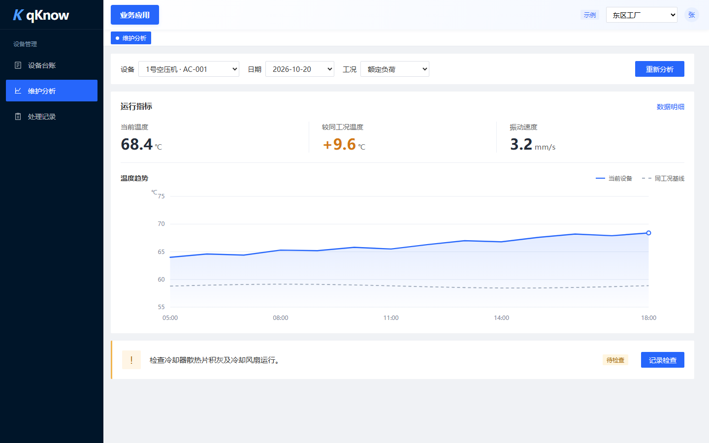
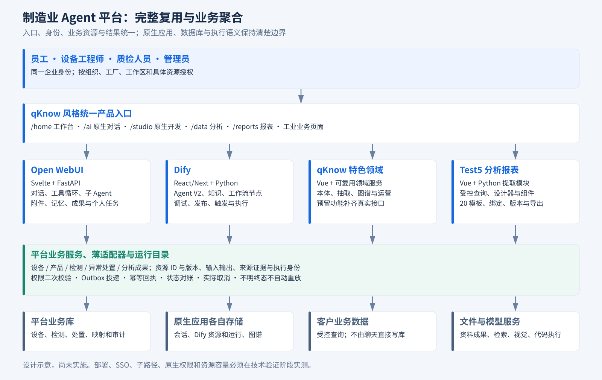

# 中国制造业 Agent 平台项目开发总纲

版本：0.2，2026-10-20。状态：**已进入实施，当前交付本机可运行切片，整体需求尚未全部验收。**

实际启动见[仓库README](../README.md)；逐项状态见[125项实施验收表](contracts/实施验收.csv)；持续进度与问题只记在[共享进度](../需求梳理/PROJECT_STATUS.md)。原设计的227操作继续保留；[代码实际OpenAPI](contracts/platform.openapi.json)单独生成，注册接口不等于功能完成。

最新用户变更（R25，覆盖此前不用Docker要求）：允许在本机D盘安装Docker，程序与镜像/卷数据显式放D盘，Windows独立进程方案保留；对话模型使用OpenCode Go `deepseek-v4.1-flash`，向量使用硅基流动`BAAI/bge-m3`，密钥只在本机加密保存。原生运行及Windows兼容边界以[部署说明](../deploy/native/README.md)的实际证据为准。

这套文档指导四个成熟项目聚合成一个企业可使用、团队可开发、客户可验收、后续可扩展的平台。保留 Open WebUI 的完整对话与 Agent 内核、Dify 的完整开发与运行能力；参考 qKnow 的界面和功能，提取 Test5 的数据分析、报表、组件与模板。新增开发集中在制造业务、统一入口、身份与资源适配、真实结果和预留功能补齐。

**规划规模：17 个模块、125 项可验收功能、75 个逻辑页面、227 项平台业务接口契约。** 这是逐条登记后计算的设计范围，不是已实现数量。Open WebUI、Dify 全部原生功能与接口按来源版本另行保留，不与本数简单相加。

## 1. 按角色阅读

| 读者 | 先看什么 | 用来决定什么 |
|---|---|---|
| 客户业务负责人、项目发起人 | 本文第2、3、7节；[产品功能与UX](01_产品功能与UX.md) | 员工如何操作、解决什么问题、效果怎样验收 |
| 产品经理、设计师 | [产品UX](01_产品功能与UX.md)、[功能清单](assets/功能清单.csv)、[页面清单](assets/页面清单.csv) | 范围、角色、操作、状态、输入输出与验收 |
| 全栈开发、架构负责人 | [架构实现](02_架构与实现设计.md)、[接口目录](contracts/接口目录.csv)、[OpenAPI](contracts/openapi.json)、[功能接口映射](assets/功能接口映射.csv) | 谁实现、数据放哪、怎么聚合与扩展 |
| 测试、实施、运维 | [开发计划与验收](03_开发计划与验收.md) | 交付依赖、场景、失败行为、部署和回滚门槛 |

只保留 **4份核心说明：本总纲＋产品UX＋架构实现＋计划验收**。目录和契约从结构化源生成；不另建重复PRD、空需求卡、独立周报或散落的决策文件。历史研究只引用原位置。

## 2. 客户应得到什么

首发假设为**单企业私有化部署**；组织、工厂、工作区、角色和具体资源权限必须生效。多客户SaaS运营和计费不自动纳入首发。

| 核心工作 | 用户操作 | 完成后的结果 |
|---|---|---|
| 设备维护 | 选设备/类别和时间窗，或在对话提出目标 | 异常特征、原因候选、趋势、维护/节能建议、原始数据与资料引用、报告 |
| 设备质检 | 打开本班任务，按检查模板提供测点或现场记录 | 每项实测、标准版本、判定、复核和处置记录 |
| 产品质检 | 选产品/批次、样本与标准，执行固定流程并复核 | 检测与缺陷证据、复检/让步申请和报告；失败或无数据不能算合格 |
| 数据处理与报表 | 提问或选处理模板，查看结果，生成并调整报表 | 有口径和来源的表格、可编辑大屏、筛选钻取、导出和版本 |
| 知识与图谱 | 上传正式资料，检查解析召回，查看引用和关系 | 原文定位、适用版本、关系来源和可复核知识 |
| 固定自动化 | 发布Dify流程，设置触发与执行范围 | 关闭聊天仍运行，任务、失败、通知和成果可回查 |

食品重点是批次/保质期和包装质量；化工重点是设备、过程异常和工况约束；纺织重点是质量等级、卷批和返工。三行业共用内核，数据映射、标准、知识、Skill、流程和报表通过版本化行业包区别。真实标准与质量阈值由企业提供并确认。

历史明确按类别配置Skill，没有要求先训练预测模型。首版维护采用数据计算、知识和维修证据分析；真实效果按样本验证，不预先承诺准确率或停机降低比例。

## 3. 界面和UX如何实现

图为[设备维护交互原型](assets/设备维护交互原型.html)的本地示例截图，不是业务系统运行结果。原型使用用户指定的 qknow-frontend-design Skill，沿用其外壳、控件、面板与滚动结构。AI页保留Open WebUI；开发者进入Dify专业工作区。普通员工不用理解节点、表结构或应用内部编号。

- 顶部按业务域切换，左侧只显示当前域菜单，右侧独立滚动。
- 聊天、流程、图谱和报表采用合适布局，只保留一套全局导航。
- 从待办和业务对象开始；页面、对话和自动化共同引用同一资源。
- 开始任务后及时显示受理/排队/失败；取消反映真实状态，刷新与断线回查原任务，避免重复提交。
- 对象和范围通过真实控件选择；只呈现当前判断所需数值、变化、状态与行动。来源和日志按需展开，避免卡片、侧栏、待办重复同一结论。
- 桌面完整操作，平板检查复核，手机以待办通知查阅为主；不承诺手机完整编辑复杂画布。

**页面文案只服务当前任务、当前数据与下一步操作。** 不常驻堆放规则、接口约束或实现解释；规则通过控件限制、字段校验、必要确认和失败反馈体现。重复标题、按钮释义及无用途说明删除。这条规则同时用于设计评审、实现与测试。

友好性由目标用户测试判断：记录完成率、用时、求助与误操作。建议首轮无开发提示完成率门槛80%，样本和门槛在原型评审确认，当前没有宣称已达到。

## 4. 功能、页面和接口数量

功能指有角色、输入输出、实现与验收条件的能力；页面是逻辑入口；接口按方法＋路径计数。下表均为规划。

| 模块 | 功能 | 页面 | 平台接口 |
|---|---:|---:|---:|
| M01 首页任务 | 7 | 4 | 13 |
| M02 AI对话 | 9 | 4 | 3 |
| M03 Agent应用开发 | 8 | 5 | 6 |
| M04 工作流自动化 | 8 | 5 | 8 |
| M05 数据源语义 | 7 | 4 | 15 |
| M06 数据分析处理 | 7 | 5 | 14 |
| M07 报表大屏模板 | 8 | 5 | 21 |
| M08 知识文档RAG | 7 | 5 | 10 |
| M09 本体抽取图谱 | 7 | 4 | 14 |
| M10 设备维护预警 | 8 | 5 | 24 |
| M11 设备及产品质检 | 8 | 6 | 23 |
| M12 工具MCP技能插件 | 7 | 4 | 10 |
| M13 应用行业方案 | 6 | 4 | 8 |
| M14 用户组织权限 | 8 | 4 | 21 |
| M15 模型凭据 | 6 | 3 | 10 |
| M16 运行运营系统 | 8 | 4 | 15 |
| M17 文件文档成果 | 6 | 4 | 12 |
| **合计** | **125** | **75** | **227** |

227项中，98项为平台聚合/领域实现，129项为来源或存储适配。**适配仍需开发和测试，不代表129项已可直接使用。** 原生聊天与Dify的全部接口继续由原项目维护；227不是整系统物理接口总数。

每项功能已映射到具体平台operationId或原生/前端承载。完整领域读模型、动态参数Schema和原生细路径，须在对应需求卡进入开发前冻结；项目级契约不等于全部字段已联调。

## 5. 整体怎样聚合

| 能力 | 负责实现 | 聚合原则 |
|---|---|---|
| 完整对话与动态Agent | Open WebUI原生前后端 | 保留消息、工具、子Agent和原生界面；业务工具返回稳定资源ID |
| Agent/知识/流程开发 | Dify原生前后端与运行组件 | 保留Agent V2、RAG Pipeline、节点、插件、触发、发布和日志 |
| 外壳、本体、抽取与图谱 | qKnow参考及可用模块 | 按业务任务组织，预留功能补真实接口 |
| 免写SQL分析与报表 | Test5指定模块 | 提取设计器、组件、模板、绑定、查询安全和直接依赖 |
| 制造业务与统一产品 | 新平台模块化服务 | 设备、产品、检查、处置、资源、身份映射、任务关联和成果 |

各系统数据库保持权威，跨域走API和事件；不共表、不直接写第三方内部库。企业知识建议Dify为主要文档索引源，qKnow图谱引用其版本；Open WebUI附件、个人知识和记忆原生保留。

身份必须映射真实账户和域内权限。Dify所需SSO、同源子路径均先验证；不可靠时采用独立应用域名和统一身份，不把简单反向代理写成集成已完成。详细ER、状态机、时序与决策见架构文档。

## 6. 一个需求怎样交给开发

设备维护分析使用 F-M10-03、P-M10-03/P-M10-04，核心operationId为 platform_m10_maintenance_analyses_create。

~~~http
POST /api/v1/maintenance-analyses
Idempotency-Key: maintenance-request-001
Content-Type: application/json
~~~

~~~json
{
  "subject_ids": ["device-pump-02"],
  "template_id": "skill-pump-maintenance",
  "template_version": 2,
  "from": "2026-10-13T08:00:00+08:00",
  "to": "2026-10-20T08:00:00+08:00",
  "analysis_goal": "maintenance",
  "knowledge_space_ids": ["kb-equipment"],
  "allow_public_search": false
}
~~~

返回202与任务号表示持久受理，不是执行成功；真实结果另查任务。时间左闭右开，默认北京时间显示；查询和检索前检查权限。请求不带数据库口令或任意可执行代码。

开发卡登记背景与效果、功能/页面/接口ID、状态、数据变更、依赖与外部调用方、负责人、建议分支、测试、上线和回滚。卡片实例在计划文档；不开工的功能不创建空文档。

平台接口使用 /api/v1/、分页、按副作用幂等、更新版本条件和事件游标；错误遵循RFC9457并携带trace_id。原生接口保留原协议，不强行统一响应包装。

## 7. 交付与验收

| 阶段 | 交付重点 | 退出标准 |
|---|---|---|
| P0 技术体验验证 | 原生构建、身份、路径、工具/Dify调用、模板换数 | 聚合接法有实际结果，关键风险有结论 |
| P1 骨架关键闭环 | 入口权限、对话工具、维护/质检/报告，74项功能首次交付 | 用户能完成业务任务 |
| P2 完整集成 | 48项功能、原生能力回归、qKnow补齐、模板与行业内容 | 全范围有页面、接口、数据和验收 |
| P3 成熟交付 | 3项后续功能、全范围权限/恢复/性能/运营和试点 | 达到生产交付条件，不是仅验收3项功能 |

按8人约7.25全职当量、客户按周参与、使用现成模型等假设，完整范围初估117—172人周、20—28日历周；P0后重估，不作已承诺工期。WBS、分支、CI、测试、备份、部署和回滚见计划文档。

验收包括：三类设备各一台维护；设备/产品质检；固定数据处理；20模板换数编辑；知识图谱引用；真实Word/Excel/PPT；后台自动化；越权、取消、断线、重复提交、持久化失败、未知终态与恢复。

指标均为目标：列表详情API P95≤2秒、首屏内容≤3秒、受理API P95≤1秒；按约定硬件、网络、数据和并发实测。初始恢复目标RPO≤24小时、RTO≤4小时，必须演练。

## 8. 后续怎样加功能

新增行业包或类别Skill优先配置；固定流程用Dify；新数据源增加provider；新图表登记组件Schema与模板；新制造业务才增加领域模块。

顺序为需求验收 → 范围页面 → 实体迁移 → 权限API → 工具流程 → UI → 边界回归 → 发布回滚。架构文档用“能耗异常分析”展示完整切片；该扩展示例不额外计入当前接口基线。行业模板与企业参数分开保存，升级不覆盖企业配置。

## 9. 文档保鲜与文件用途

| 位置 | 维护规则 |
|---|---|
| 4份核心Markdown | 维护职责、决策、流程和验收，避免同一事实各写一遍 |
| 范围基线.json | 产品功能、页面、归属、阶段与验收事实源 |
| contracts/接口基线.json | 操作、字段、权限与功能承载映射事实源 |
| 设计目录CSV、设计OpenAPI、统计/校验JSON | 由build_docs生成，与设计事实源一起更新 |
| contracts/platform.openapi.json | 由tools/export_api.py从代码生成，用于实际联调 |
| contracts/实施验收.csv | 协调者依据实际验证证据维护，不由build_docs覆盖 |
| assets架构SVG/PNG | 架构矢量原图和阅读副本 |
| assets/设备维护交互原型.html、ux-workbench.png | 独立桌面原型和浏览器截图；仅本地示例交互，不接真实服务 |
| tools | 从事实源生成目录/契约和架构图，不访问数据库与模型 |
| 需求梳理/历史材料 | 只链接，不复制进本目录 |

重建目录时也会刷新正文数量摘要和模块统计表；若段落结构变化导致无法定位，工具报错，避免继续保留旧数量：

~~~powershell
python 项目文档/tools/build_docs.py
~~~

共享记录继续唯一沿用 [PROJECT_STATUS](../需求梳理/PROJECT_STATUS.md) 和 [FILE_INDEX](../需求梳理/FILE_INDEX.md)，不新建第二份。改需求、页面、接口或验收时，在同一开发卡和共享记录追加变更。过期结论注明替代来源。

## 10. 依据与开发前验证

内部依据：[四项目核查总表](../需求梳理/四项目复用核查与历史需求总表_20261020.md)、[历史需求归纳](../需求梳理/Codex历史需求归纳_20261020.md)。缺失原日志和粘贴的旧AI报告不当完成证据。

技术参考：[Open WebUI SSO](https://docs.openwebui.com/features/authentication-access/auth/sso/)、[部署加固](https://docs.openwebui.com/getting-started/advanced-topics/hardening/)、[Dify触发](https://dify.ai/blog/introducing-trigger)、[OpenAPI3.1.1](https://spec.openapis.org/oas/v3.1.1.html)、[RFC9457](https://www.rfc-editor.org/rfc/rfc9457)、[WCAG2.2](https://www.w3.org/TR/WCAG22/)。API细节按锁定本地版本核验。

开发前确认真实标准与样本、目标环境和规模、模型网络范围、身份接法、许可品牌条件、模板差异和迁移清单；各有责任角色和验证阶段，不以“待定”掩盖产品范围。

文档设计阶段的交付已结束，当前已进入业务代码实施和本机隔离验证。实际结果以逐项实施验收表及共享进度为准；性能、周期和企业现场效果仍属于待验证目标。
